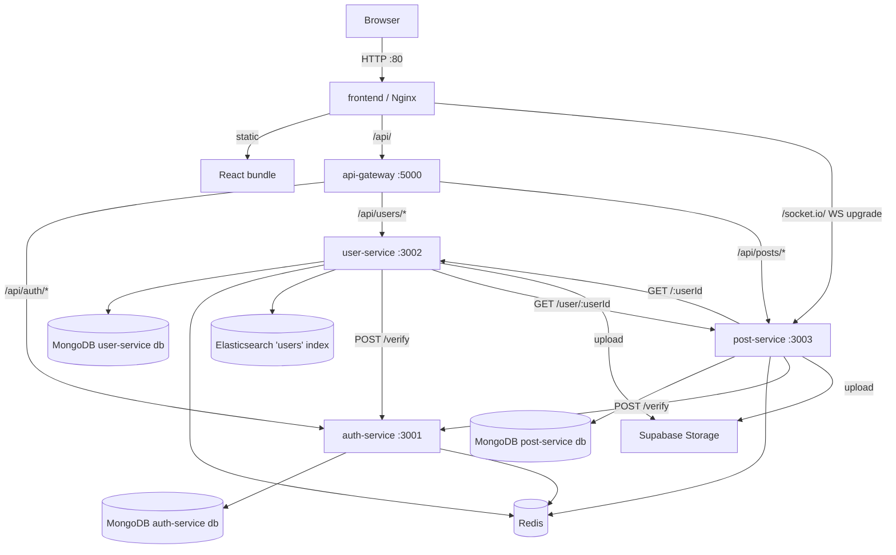
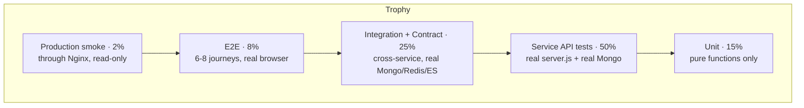
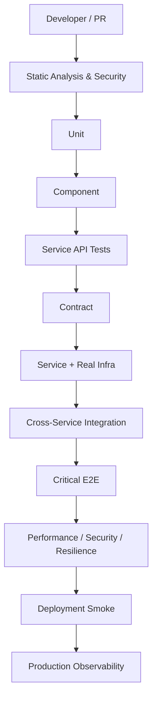
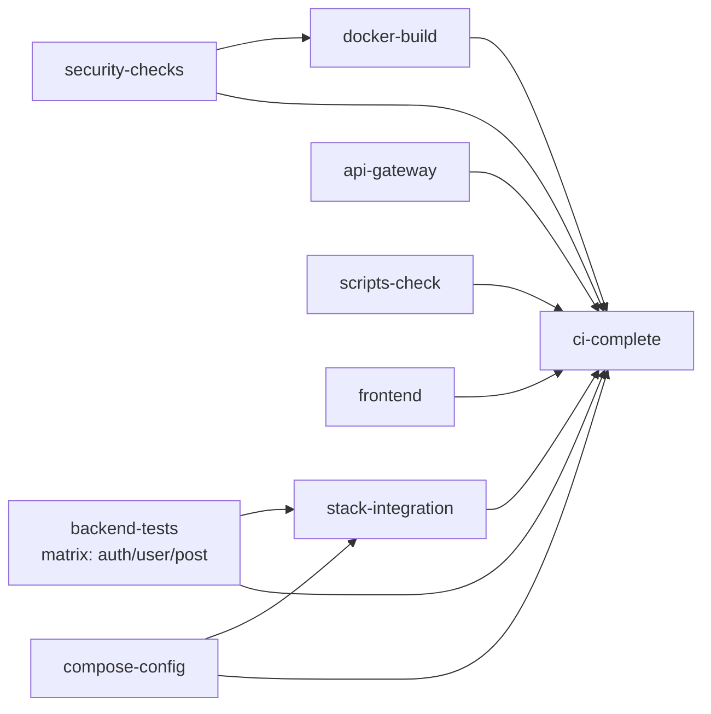
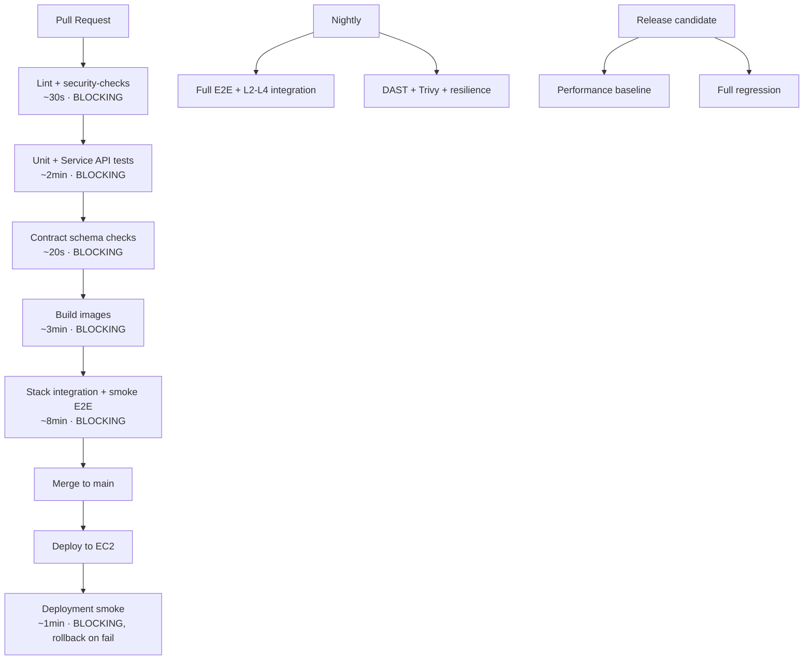

# Test Plan — social-media-mini

**System:** social-media-mini
**Authoritative architecture:** `docker-compose.microservices.yml`
**Deployment target:** single AWS EC2 instance, Docker Compose
**Document status:** derived from source inspection, not from documentation

This is the **operational** testing document: what exists, how to run it, what
each service needs, what is known to be broken, and the detailed per-area
analysis behind every recommendation.

**Policy lives in [TEST-STRATEGY.md](TEST-STRATEGY.md)** — what we test and why,
ownership, quality-gate rules, coverage interpretation, version governance, and
how flaky or failing tests are handled. This plan does not restate those rules;
where one applies it links to the strategy. Read the strategy for the decision,
this plan for the detail and the commands.

This file was previously named `TEST-STRATEGY.md`. It was renamed when the two
documents were separated; the detailed content below is unchanged apart from the
curation noted in each affected section.

Every claim in this document was verified against the repository. Where the
repository could not answer a question, it says so explicitly rather than
guessing.

---

## Executive Summary

### What the system is

Eight containers on one Docker bridge network (`microservices-network`): an
Nginx-served React SPA, an API gateway, three Node/Express services, and three
backing stores (MongoDB, Redis, Elasticsearch). Images live in Supabase
Storage. Real-time updates use Socket.IO served by post-service and proxied by
Nginx, bypassing the gateway.

On `main`, **only the frontend's port 80 is published**; the gateway, the three
services and all three backing stores are reachable only inside the Docker
network. That single fact shapes the entire test strategy: almost no test can
reach a backend service from outside the stack, so test execution must happen
either in-process, inside the network, or through Nginx.

### The central quality finding

The repository reports **80 passing tests**. That number materially overstates
the assurance it provides.

All three service suites — `auth.test.js`, `user.test.js`, `post.test.js` —
**rebuild a replica Express application inside the test file** instead of
importing the service's own `server.js`. They test a hand-written copy of the
logic, which can and does diverge from what ships.

Two concrete proofs, both verified:

1. `auth.test.js` contains a test named *"should validate email format"* that
   passes against an `emailRegex` defined in the test file. **Production
   `services/auth-service/server.js` contains no email validation at all**
   (`grep -c emailRegex server.js` → `0`). A green suite is asserting behaviour
   the product does not have.

2. `post.test.js` re-implements `extractYouTubeId` inside its replica (line 76)
   — and the copy has **already drifted**. Production has three URL patterns
   (`watch?v=`/`youtu.be`, `/embed/`, `/v/`) plus an `if (!url) return null`
   guard. The replica has **two patterns and no guard**. So the suite cannot
   detect a regression in the `/v/` branch, and would not notice that the
   replica throws on `null` where production returns `null`.

Divergence is not hypothetical here; it has already happened in two places.

Of the 80 tests, only the 34 in `imageType.test.js` (17 per service) exercise a
real production module. **Roughly 42% of the suite tests shipped code; 58%
tests a replica.** Closing that gap is Priority 1 and is cheap — post-service
already does `export default app`.

### Quality risks, ranked

1. **Test/implementation divergence** — the suite can stay green while the
   product breaks.
2. ~~Unauthenticated `POST /sync-user`~~ — **resolved.** It now requires a
   shared internal service token (`x-internal-token`), compared in constant
   time; both services refuse to start without it.
3. ~~Unauthenticated `GET /api/users/:userId`~~ — **resolved.** It now requires
   `protect`, and post-service forwards the caller's token on author lookups.
4. **No input validation beyond presence checks** — no email format, no
   password strength, no length caps on post or comment text.
5. ~~`post.image` accepted verbatim from the request body~~ — **resolved.**
   `POST /` and `PUT /:postId` now accept only an https URL on the configured
   upload origin; the same guard covers `profilePic` on `PUT /me`.
6. **Zero frontend test tooling** — no Vitest, Testing Library, Playwright or
   Cypress. The SPA holds the auth token in `localStorage` and has no automated
   coverage whatsoever.
7. **Cross-service trust is untested** — every protected route depends on an
   HTTP call to `auth-service /verify`, and no automated test exercises that
   boundary.

### Testing and automation philosophy

Moved to policy: see [TEST-STRATEGY.md §2 Testing principles and risk-based
priorities](TEST-STRATEGY.md#2-testing-principles-and-risk-based-priorities).
In short — a Testing Trophy rather than a pyramid, because this codebase has
almost no pure domain logic; the reasoning from the code is in §2.1 below.

### Target distribution

| Layer | Target | Today |
| --- | --- | --- |
| Unit (pure functions) | 15% | 34 tests, all `imageType` |
| Service/API tests against real Mongo | 50% | 46 tests, but against replicas |
| Cross-service integration | 15% | 1 file, untracked, currently failing |
| Contract | 10% | none |
| E2E through Nginx | 8% | none |
| Production smoke | 2% | none |

Percentages are a shape, not a gate. Nobody should block a PR because a ratio
moved.

### CI/CD in one line

Nine jobs exist today on Node 22 (`security-checks`, `backend-tests`,
`api-gateway`, `scripts-check`, `frontend`, `compose-config`, `docker-build`,
`stack-integration`, `ci-complete`) with a real stack boot and health
verification. The pipeline skeleton is genuinely good; what it runs inside that
skeleton is thin.

### Maturity roadmap

Six phases, detailed at the end. Phase 1 is a two-week correction: point the
existing tests at the real applications and add the missing authorization
tests. Everything else is optional until the product has users.

---

## 0. Running the tests today

Everything in this section was executed on this repository; the figures are
measured, not estimated.

### 0.1 What exists to run

| Location | Command source | Suites | Measured result |
| --- | --- | --- | --- |
| `services/auth-service` | `package.json` `test` | `auth.test.js` | **18 pass** |
| `services/user-service` | `package.json` `test` | `user.test.js`, `imageType.test.js` | **27 pass** |
| `services/post-service` | `package.json` `test` | `post.test.js`, `imageType.test.js` | **35 pass** |
| `services/api-gateway` | — | none | **no `test` script** |
| `social-media-mini-frontend` | `package.json` | none | **no test tooling at all** |

**80 tracked tests.** Of those, the `imageType.test.js` pair (17 per service) is
the only part importing a production module — see §2.3 and C1 in §30.

What that pair actually asserts, since it is the repository's only real
coverage of shipped code: `detectImageType` accepts **JPEG, PNG, GIF87a,
GIF89a and WebP** by magic bytes, and rejects **ELF and PE executables, shell
scripts, HTML, SVG, PDF, truncated signatures, and RIFF containers that are not
WebP** — so neither the browser-supplied `Content-Type` nor the filename is
trusted. SVG is excluded deliberately: it is a scriptable format.

`services/auth-service` also contains an **untracked** integration test,
`verify-cross-service.integration.test.js`. Jest picks it up because it matches
the default test pattern, and it **fails** — see Appendix A item 6 for why. So
`npm test` in `auth-service` exits non-zero on a working tree that has that
file, while `auth.test.js` itself passes 18/18. CI never sees it: it is not in
git.

### 0.2 Prerequisites

- **Node.js 22.** The version CI uses (`NODE_VERSION` in
  [`.github/workflows/ci.yml`](../../.github/workflows/ci.yml)) and the version
  every service image is built on. **No `package.json` declares an `engines`
  field**, so nothing enforces this at install time — getting it wrong fails at
  runtime, not at `npm ci`.
- **npm** with the committed `package-lock.json` (lockfileVersion 3) in each
  service. Use `npm ci`, not `npm install`: CI asserts the lockfile is
  unchanged afterwards.
- **No database, Docker or network service is needed** for the three service
  suites. `mongodb-memory-server` supplies MongoDB in-process.
- **One-time network access** for `mongodb-memory-server`, which downloads a
  `mongod` binary on first use and caches it **outside the repository** (on this
  machine, `~/.cache/mongodb-binaries`). Subsequent runs are offline, and the
  cache survives deleting `node_modules`.
- **Docker with the Compose plugin** only for the stack-level checks in §9 and
  §21 — never for the service suites.

### 0.3 Commands

```bash
# per service: auth-service | user-service | post-service
cd services/auth-service
npm ci                    # install exactly what the lockfile pins
npm test                  # the suite
npm run test:watch        # re-run on change
npm run test:coverage     # suite + coverage report
```

All three `test` scripts are identical:
`node --experimental-vm-modules node_modules/jest/bin/jest.js
--detectOpenHandles --forceExit`. The `--experimental-vm-modules` flag is
required because the services are ES modules; `transform: {}` in each
`package.json` `jest` block disables Babel for the same reason, and
`testTimeout` is **30000 ms**.

Measured wall-clock on Node 22: auth-service ~13 s (`auth.test.js` alone),
user-service ~9 s, post-service ~7 s.

### 0.4 Coverage reporting

`npm run test:coverage` writes `services/<service>/coverage/` — `clover.xml`,
`coverage-final.json`, `lcov.info`, and an `lcov-report/` HTML tree. Open
`lcov-report/index.html` to read it.

**These outputs are generated artifacts and are not tracked.** 33 of them were
committed historically; the `coverage/` and `**/coverage/` ignore rules were
added and the files were removed from the index, leaving them on disk. Do not re-add them.

How to interpret the numbers — and why they currently mislead — is in §22, and
the policy is in
[TEST-STRATEGY.md §7](TEST-STRATEGY.md#7-coverage-policy-and-how-to-read-it).

### 0.5 What CI runs, and what it does not

[`.github/workflows/ci.yml`](../../.github/workflows/ci.yml) is the authority;
§21.1 describes all nine jobs. For running tests specifically, `backend-tests`
is a three-way matrix (`auth-service`, `post-service`, `user-service`) with
`fail-fast: false` that does `npm ci` → `git diff --exit-code` on the lockfile →
`npm test`. **It does not run coverage**, so no coverage gate is enforced today
regardless of what §22 targets.

`api-gateway` has no suite, so its job runs `node --check server.js` plus a real
boot with liveness verification. `frontend` runs ESLint, a production build and
a bundle secret scan — no tests, because none exist.

### 0.6 Troubleshooting

| Symptom | Cause | Action |
| --- | --- | --- |
| `npm ci` fails with a lockfile/`package.json` mismatch | The lockfile is stale relative to `package.json` | Run `npm install` once, commit the lockfile; CI's `git diff --exit-code` step exists to catch exactly this |
| First `npm test` hangs for a long time | `mongodb-memory-server` is downloading `mongod` | Allow network once; it caches outside the repo (§0.2) |
| `auth-service` `npm test` fails but `auth.test.js` passes | The untracked `verify-cross-service.integration.test.js` is present and failing | Expected; see §0.1 and Appendix A item 6. Run `npx jest auth.test.js` to scope the run |
| A register-then-search assertion fails intermittently | Elasticsearch indexing is asynchronous | Poll with a bound, never `sleep` — §14 and §25 |
| Tests pass locally, stack job fails in CI | The suites never touch the stack; the stack job boots eight containers | Read the job's diagnostics step, not the unit-test output — §21.1 |
| Jest reports open handles | Mongo/Redis clients not closed in a teardown | `--detectOpenHandles --forceExit` is already set; fix the teardown rather than relying on it |

---

## 1. Verified Architecture — System Under Test

### 1.1 Services

Confirmed against `docker-compose.microservices.yml`.

| Compose service | Container name | Internal port | Published to host |
| --- | --- | --- | --- |
| `frontend` | `social-media-frontend` | 80 | **80 — only public port** |
| `api-gateway` | `api-gateway` | 5000 | no |
| `auth-service` | `auth-service` | 3001 | no |
| `user-service` | `user-service` | 3002 | no |
| `post-service` | `post-service` | 3003 | no |
| `mongodb` | `social-media-mongodb` | 27017 | no |
| `redis` | `social-media-redis` | 6379 | no |
| `elasticsearch` | `social-media-elasticsearch` | 9200, 9300 | no |

All eight on `microservices-network` (bridge). Volumes: `mongodb_data`,
`redis_data`, `elasticsearch_data`.

> **Note on host exposure.** The table above is the configuration on `main`:
> `frontend` is the only service with a `ports:` mapping, so it is the only one
> reachable from the host. Any test design that assumes host access to a backend
> is wrong by construction.
>
> *Historical:* an earlier revision of this stack published every service's
> port, and the closure landed later. Earlier revisions of this document were
> written against that configuration; the closed form is now the baseline.

### 1.2 Request paths



Two things in that diagram matter disproportionately for testing:

- **Socket.IO bypasses the gateway.** Nginx proxies `/socket.io/` straight to
  post-service:3003 with `proxy_http_version 1.1` and `Upgrade`/`Connection`
  headers. Any test of real-time behaviour must go through Nginx, not the
  gateway.
- **`/verify` is the trust chokepoint.** user-service and post-service both
  authenticate every protected request by POSTing the token to
  `auth-service:3001/verify`. If that call is wrong, every authorization
  decision in the system is wrong.

### 1.3 Startup ordering

`depends_on: condition: service_healthy` throughout:

```
mongodb, redis                                → auth-service
mongodb, redis, elasticsearch, auth-service   → user-service
mongodb, redis, auth-service, user-service    → post-service
auth-service, user-service, post-service      → api-gateway
api-gateway                                   → frontend
```

Health checks: `mongosh --eval 'db.runCommand({ping:1}).ok'` (direct, not a
shell pipeline — deliberate), `redis-cli ping`, `curl -f
.../_cluster/health`, and `wget --spider http://localhost:<port>/health` for
the four Node services. `frontend` declares none.

Testing consequence: Elasticsearch has a 30s health interval and gates
user-service, which gates post-service and the gateway. **Cold stack startup is
minutes, not seconds.** Any CI job that boots the stack must budget for it, and
no per-test-file stack boot is affordable.

### 1.4 Complete API surface

Verified by reading each `server.js`.

**auth-service** (3001)

| Method | Path | Auth | Rate limit |
| --- | --- | --- | --- |
| GET | `/health` | none | none |
| POST | `/register` | none | `authLimiter` 50 / 15 min |
| POST | `/login` | none | `authLimiter` 50 / 15 min |
| POST | `/verify` | none (token in body) | **none** |

**user-service** (3002)

| Method | Path | Auth | Rate limit |
| --- | --- | --- | --- |
| GET | `/health` | none | none |
| POST | `/upload` | `protect` | 20 / hr |
| POST | `/sync-user` | internal service token | **none** |
| GET | `/me` | `protect` | none |
| GET | `/search` | `protect` | 30 / min |
| PUT | `/me` | `protect` | none |
| GET | `/me/posts` | `protect` | none |
| GET | `/:userId` | **none** | none |
| GET | `/:userId/posts` | `protect` | none |

**post-service** (3003)

| Method | Path | Auth | Rate limit |
| --- | --- | --- | --- |
| GET | `/health` | none | none |
| POST | `/upload` | `protect` | 30 / hr |
| POST | `/` | `protect` | 20 / hr |
| GET | `/` | `protect` | none |
| DELETE | `/:postId` | `protect` + ownership | none |
| PUT | `/:postId` | `protect` + ownership | none |
| GET | `/user/:userId` | `protect` | none |
| POST | `/:postId/comments` | `protect` | 50 / hr |
| POST | `/:postId/comments/:commentId/replies` | `protect` | 50 / hr |
| DELETE | `/:postId/comments/:commentId` | `protect` + ownership | none |
| DELETE | `/:postId/comments/:commentId/replies/:replyId` | `protect` + ownership | none |
| PUT | `/:postId/like` | `protect` | 100 / hr |
| PUT | `/:postId/unlike` | `protect` | 100 / hr |

**api-gateway** (5000): `GET /health`, `GET /api/health/all` (aggregates the
three services, 200 / 503), and three proxies with a global limiter of
100 / 15 min on `/api`. Path rewrite strips `/api/<service>`, so
`/api/auth/register` arrives as `/register`.

### 1.5 Data model

MongoDB, three separate databases, no cross-database joins.

- `auth-service.users` and `user-service.users` share an identical schema:
  `firstName`, `lastName`, `email` (unique), `password`, `bio`, `profilePic`,
  `createdAt`. **The same user is stored twice**, kept in sync only by the
  registration-time `POST /sync-user` call. This duplication is the system's
  primary data-integrity risk.
- `post-service.posts`: `user` (ObjectId), `text`, `image`, `youtubeUrl`,
  `likes[]`, `comments[]` with nested `replies[]`, `createdAt`.

Comments and replies are **embedded subdocuments**, not separate collections.
That bounds a post document's growth and makes comment deletion a
`post.save()` of the whole document — relevant to both concurrency and
performance testing.

### 1.6 Redis usage

| Key | Writer | TTL | Invalidated by |
| --- | --- | --- | --- |
| `verify:<sha256(token)>` | auth-service | 5s | TTL only |
| `user:<id>` | user-service | 600s | `PUT /me` |
| `posts:feed:global` | post-service | 300s | 9 post-service mutations + `PUT /me` on user-service |

Three verified design points worth testing explicitly:

- The verify cache is keyed on a **SHA-256 digest** of the bearer token, not the
  token, so a Redis key dump yields nothing usable.
- A cache miss or Redis outage falls through to full `jwt.verify` plus a
  database lookup. **It never fails open.**
- The feed cache is a single global key because the feed is identical for every
  viewer (`Post.find()` with no user filter). `user-service PUT /me` deletes
  `posts:feed:global` because author names and avatars are embedded in the
  cached payload — a genuinely subtle cross-service cache dependency and a prime
  integration-test target.

**Known, bounded correctness gap:** within the 5s verify TTL, a deleted or
just-expired token still authorizes. This is an accepted trade-off, not a bug,
but it must be an *asserted* trade-off.

### 1.7 Elasticsearch usage

Single index `users`, created at startup if absent with explicit mappings
(`firstName`, `lastName`, `email`, `bio`, `fullName`, each `text` with a
`keyword` subfield). Written on `POST /sync-user` (`esClient.index`) and
`PUT /me` (`esClient.update`). Read by `GET /search` using a three-clause
`bool.should`: `phrase_prefix` (boost 5–6), `multi_match` with
`fuzziness: AUTO` (boost 2–4), and a `query_string` wildcard on `.keyword`
fields, `minimum_should_match: 1`, `size: 10`.

**Fallback is real and testable:** if `esClient` is null, if the search throws,
or if Elasticsearch returns zero hits, the code falls through to a MongoDB
`$regex` query across `firstName`, `lastName`, `email`, limited to 10. That
means search degrades rather than fails — and the two paths return *different
rankings*, which is exactly the kind of thing that needs an explicit test so
nobody "fixes" the fallback into inconsistency.

### 1.8 Socket.IO

post-service emits nine events: `post:created`, `post:deleted`, `post:updated`,
`comment:added`, `reply:added`, `comment:deleted`, `reply:deleted`,
`post:liked`, `post:unliked`. The frontend subscribes to all nine plus
`connect` and `disconnect`. CORS on the Socket.IO server is `origin: "*"` and
connections are **not authenticated** — any client that can reach the endpoint
receives every feed event. Since the feed is public to authenticated users
anyway the exposure is limited, but it should be a conscious, documented
decision, and it is a legitimate security test case.

### 1.9 Frontend

React + Vite, served by Nginx from a two-stage build (`node:22-alpine` →
`nginx:alpine`). Routes: `/login`, `/register`, `/feed`, `/profile`, `/search`,
`/user/:userId`, and `/` (renders Login). `ProtectedRoute` gates the
authenticated routes on the presence of a `localStorage` token.

All API calls are **relative** (`/api/...`, `io({ path: "/socket.io" })`) with
no absolute host anywhere in `src/`. This is excellent for testability: the same
bundle works behind Nginx, behind the Vite dev proxy, and behind a test proxy.

Auth state: `localStorage` holds `token` and a JSON `user`. `PostItem.jsx` reads
`JSON.parse(localStorage.getItem("user") || "{}")` to decide whether to show
edit/delete controls — a **client-side authorization display decision**, which
makes it essential to verify the *server* enforces ownership independently. It
does (four `403 Not authorized` checks in post-service), and that must be
regression-protected.

### 1.10 Testability assessment

| Service | Exports app? | Guards side effects under `NODE_ENV=test`? |
| --- | --- | --- |
| `auth-service` | ❌ no | ✅ yes |
| `user-service` | ❌ no | ❌ **no — connects and listens on import** |
| `post-service` | ✅ `export default app` | ✅ yes |
| `api-gateway` | ❌ no | ❌ no |

This table explains why the tests are replicas: two services cannot be imported
without side effects, and three do not export an app. **post-service is
importable today** and is the obvious first service to convert.

`api-gateway` additionally builds its proxy middleware at module scope and
throws if `AUTH_SERVICE_URL`/`USER_SERVICE_URL`/`POST_SERVICE_URL` are
undefined — so any in-process test must supply them.

---

## 2. Test Distribution — Trophy, Not Pyramid

### 2.1 Why not a pyramid

The textbook pyramid assumes a thick layer of pure domain logic that can be
tested without I/O. This codebase does not have one. Business rules live inside
route handlers, interleaved with `Post.findById`, `redisClient.get` and
`axios.post`. There are exactly two genuinely pure modules in the repository:
`services/post-service/imageType.js` and its user-service twin.

Writing "unit tests" for a route handler here would mean mocking Mongoose,
Redis and Axios — at which point the test asserts that the mocks were called,
not that the feature works. That is a test that fails when you refactor and
passes when you break the product: the worst possible trade.

### 2.2 The recommended shape



The bulge is deliberately at **service API tests**: import the real
`server.js`, run it against an ephemeral MongoDB, drive it over HTTP with
Supertest, stub only what crosses a process boundary (`/verify`, Supabase).
That layer is fast (seconds), hermetic, and tests shipped code.

### 2.3 Honest accounting of today

| Layer | Tests | Tests *shipped* code? |
| --- | --- | --- |
| Unit | 34 (`imageType` ×2) | ✅ yes |
| Service API | 46 (auth 18, user 10, post 18) | ❌ **no — replica apps** |
| Integration | 1 file, untracked, failing | n/a |
| Contract | 0 | — |
| E2E | 0 | — |
| Production smoke | 0 | — |

---

## 3. Microservices Test Architecture



### Layer specifications

**L0 — Static analysis & security**
*Purpose:* catch defects without executing the product.
*Scope:* ESLint on the frontend; `scripts/ci-security-checks.sh` (23 assertions
covering regression patterns and committed secrets); CodeQL; `npm ci` lockfile
reproducibility.
*Mocked:* nothing. *Real infra:* none. *Speed:* seconds.
*Frequency:* every push. *CI stage:* `security-checks`, `frontend`.
*Owner:* whoever opens the PR. *Gate:* **blocking.**
*Already implemented and genuinely good.* The security script is
negative-tested — twelve known regressions were each injected and confirmed to
fail the build. That is rare and worth preserving.

**L1 — Unit**
*Purpose:* exhaustive edge-case coverage of pure logic.
*Scope:* `imageType.js` magic-byte detection. Future: a token-cache key
helper, `extractYouTubeId`.
*Mocked:* nothing — pure functions take buffers and strings.
*Speed:* milliseconds. *Frequency:* every push. *Gate:* **blocking.**
`extractYouTubeId` in post-service is pure, has three regex branches, and is
**currently untested** — a free win.

**L2 — Component**
*Purpose:* a single handler or middleware in isolation.
*Scope:* the `protect` middleware; the multer error handler; `clearFeedCache`
behaviour when Redis is down.
*Mocked:* Axios (`/verify`), the Redis client.
*Speed:* milliseconds. *Gate:* blocking.
Thin by design — `protect` is the one piece of middleware whose failure modes
justify isolated tests, because it is the authorization chokepoint.

**L3 — Service API tests** ← *the investment layer*
*Purpose:* verify a service's real HTTP contract and real persistence.
*Scope:* every row of the API tables in §1.4, for the real `server.js`.
*Mocked:* only cross-process calls — `auth-service /verify` (stub returning a
known user), Supabase Storage, and post-service↔user-service population calls.
*Real infra:* **MongoDB**, via `mongodb-memory-server`, already a devDependency
in all three services.
*Speed:* 10–20s per service (today's suites run in ~13–19s).
*Frequency:* every push. *CI stage:* `backend-tests` matrix.
*Owner:* service owner. *Failure isolation:* excellent — the matrix has
`fail-fast: false`, so one service failing does not mask another.
*Gate:* **blocking, 100% pass.**

**L4 — Contract**
*Purpose:* stop a provider changing a response shape a consumer depends on.
*Scope:* see §7 — only two pairings earn it.
*Speed:* seconds. *Frequency:* every push. *Gate:* blocking once it exists.

**L5 — Service + real infra**
*Purpose:* verify behaviour that only appears against the real engine.
*Scope:* Elasticsearch query relevance and mapping; Redis TTL expiry and
eviction; Mongo unique-index violation on duplicate `email`.
*Real infra:* real Redis and Elasticsearch containers.
*Speed:* minutes (ES startup dominates). *Frequency:* **nightly**, not per-PR.
*Gate:* non-blocking on PRs; blocking for a release candidate.

**L6 — Cross-service integration**
*Purpose:* verify the trust and data flows between services.
*Scope:* the registration→sync saga and its rollback; `protect` against a live
auth-service; the `PUT /me` → `posts:feed:global` invalidation.
*Real infra:* the full Compose stack.
*Speed:* minutes including stack boot. *CI stage:* `stack-integration`.
*Owner:* platform/QA jointly. *Gate:* blocking on `main`.

**L7 — Critical E2E**
*Purpose:* prove the assembled system delivers the journey.
*Scope:* 6–8 journeys (§8). Driven through Nginx on port 80 — the only
reachable surface.
*Speed:* minutes. *Frequency:* pre-merge to `main` + nightly.
*Gate:* critical suite blocking; extended suite informational.

**L8 — Non-functional**
*Purpose:* characterise behaviour under load, attack and failure.
*Frequency:* on demand and before a release. *Gate:* informational against
agreed baselines.

**L9 — Deployment smoke**
*Purpose:* confirm the deployed stack is actually serving.
*Scope:* `curl -I http://localhost`, `curl /api/health/all`, one read-only
login against a seeded account.
*Speed:* seconds. *Gate:* blocking — failure triggers rollback.

**L10 — Production observability**
*Purpose:* detect what tests did not.
*Scope:* see §19. *Gate:* alerting, not blocking.

---

## 4. Service-by-Service Strategy

### 4.1 auth-service

**Responsibility.** Credential storage, JWT issuing, and token verification for
the whole system. The single most security-critical component.

**APIs.** `GET /health`, `POST /register`, `POST /login`, `POST /verify`.

**Dependencies.** MongoDB (`auth-service` db), Redis (optional cache),
user-service via `POST /sync-user` (outbound, at registration).

**Verified behaviour worth testing.**
- Startup refuses to run when `JWT_SECRET` is unset *or empty* — verified exit
  code 1 for both.
- `bcrypt.hash(password, 10)`.
- JWT `expiresIn: '7d'`, payload `{ id }` only.
- Registration syncs to user-service with **bounded retry: 3 attempts, backoff
  `attempt * 1000` ms**; on total failure it deletes the auth user and returns
  **503**. Rollback failure is caught and logged with the orphaned id.
- `/verify` reads `req.body?.token` — optional chaining, so a body-less POST
  returns `401 No token provided` rather than a 500.

**Unit.** A cache-key helper (`sha256`) if extracted. Currently none possible.

**API tests.** Convert `auth.test.js` to import `server.js`. Then:
`/register` — missing each field (4 cases), duplicate email, **email format
(currently a replica-only test that will fail against production — that failure
is the correct outcome and should drive a product fix)**, password length
boundaries. `/login` — correct, wrong password, unknown email, missing field.
`/verify` — valid, malformed, expired, missing token, no body, token signed
with a different secret, token for a deleted user.

**Integration.** The sync saga: success; 3× failure → rollback + 503 + no
orphaned record; transient failure recovering on attempt 2; retry after
rollback not producing duplicates. The existing replica tests cover all four —
they just need to point at the real app.

**Contract.** Provider for `/verify`. See §7 — this is the one contract that
matters.

**Negative.** SQL/NoSQL injection in `email` (e.g. `{"$ne": null}` as the email
value — Mongoose casts to string so this should be safe, **verify it**);
oversized bodies against the `10mb` limit; `Content-Type` mismatches.

**Security.** Timing differences between "unknown email" and "wrong password"
(both return `401 Invalid credentials` — good, assert it stays that way);
`authLimiter` 50/15min enforcement and reset; password never present in any
response (`select("-password")`); bcrypt cost not silently lowered.

**Performance.** bcrypt cost 10 is ~100ms of CPU per login. On a 2-vCPU EC2
instance that caps login throughput around 20/s/core. **This is the system's
first bottleneck under a login spike** and the right place to start load
testing.

**Resilience.** Redis down → full verification path, never fail open (assert
explicitly). MongoDB down → `connectDB` calls `process.exit(1)`; verify the
container restarts and the health check reflects the outage.

**Observability.** Logs `MongoDB Connected`, `Redis Connected`, and
`Sync attempt N/3 failed`. The `stack-integration` job already asserts the first
two.

**Critical risks.** Verify-cache staleness (5s); the dual-write to user-service;
no email/password validation.

### 4.2 user-service

**Responsibility.** Profile storage, profile-picture upload, user search.

**APIs.** Nine routes (§1.4). All require a user token except `/health` and
`/sync-user`, which is authenticated with an internal service token instead.

**Dependencies.** MongoDB (`user-service` db), Redis (`user:<id>`, 600s),
Elasticsearch (`users` index), auth-service `/verify`, post-service for
`/me/posts` and `/:userId/posts`, Supabase Storage.

**Critical risks — both were verified and both are now fixed.**

1. **`POST /sync-user` had no authentication — now fixed.** Through the gateway,
   `POST /api/users/sync-user` is internet-reachable and creates a user from a
   fully attacker-controlled body: `_id`, `firstName`, `lastName`, `email`,
   `password`, `createdAt`. The `password` is stored **verbatim** — the endpoint
   expects an already-hashed value and does not hash. An attacker can inject
   arbitrary profiles, including ones that will appear in search results, and
   can choose the `_id`. The existence check (`User.findById(_id)` → early
   return) prevents overwriting, but seeding a profile whose `_id` a future
   registration might target would make that registration's sync return
   `"User already exists"` and succeed against attacker-controlled data.
   *Resolved:* the endpoint now requires `x-internal-token`, which only
   auth-service holds. An unauthenticated call returns 401.

2. **`GET /:userId` had no authentication — now fixed.** `GET /api/users/<id>` returned the
   profile including `email`. PII exposure plus enumeration.
   *Resolved:* the route now carries `protect`.

Both were product defects rather than test defects, and both were fixed before
this repository was published.

**API tests.** `/me` GET and PUT (including the documented "should not update
email" behaviour); `/search` with empty query → `[]`, no match, missing `q`;
`/upload` happy path plus the five rejection modes; the two formerly
unauthenticated routes above, now asserted to reject anonymous callers;
`/:userId` with a malformed ObjectId (cast error → 500 today; should be 400 —
assert and fix).

**Integration.** `PUT /me` must delete both `user:<id>` **and**
`posts:feed:global`; the ES document must be updated so a subsequent `/search`
reflects the new name; upload → Supabase → URL persisted.

**Resilience.** ES down → MongoDB regex fallback returns results (assert
non-empty for a known user); Redis down → `/me` still answers from Mongo;
post-service down → `/me/posts` currently returns **500**, not a degraded empty
list. Worth a product decision.

**Testability blocker.** Does not export its app and connects/listens on
import. Must be fixed before in-process API tests are possible.

### 4.3 post-service

**Responsibility.** Posts, embedded comments and replies, likes, the global
feed with its cache, post-image upload, and the Socket.IO server.

**APIs.** Thirteen routes (§1.4), four with ownership enforcement.

**Dependencies.** MongoDB (`post-service` db), Redis
(`posts:feed:global`, 300s), auth-service `/verify`, user-service for author
population, Supabase Storage.

**Verified behaviour worth testing.**
- Feed is global and unfiltered; one cache key; invalidated at **all nine**
  mutation sites (verified by mapping routes to `clearFeedCache()` calls).
- Author population is an **N+1 fan-out**: one `GET /:userId` to user-service
  per post, plus one per comment, plus one per reply. For a 20-post feed with
  comments this is easily 50+ sequential HTTP calls on a cache miss. **The
  dominant performance risk in the system.**
- Ownership: four `403 Not authorized` checks on post update/delete and
  comment/reply delete.
- `extractYouTubeId` validates and rewrites YouTube URLs to `/embed/` form;
  an unrecognised URL silently becomes `null`.

**Critical risk — verified.** `POST /` takes `image` straight from the request
body with no validation. A client can skip `/upload` entirely and store any
string, including a multi-megabyte `data:` base64 blob or an external URL. This
**reopens the base64-in-MongoDB problem** that the upload hardening was meant to
close, and bypasses the magic-byte validation completely.
*Test:* `POST /api/posts` with `image: "data:image/png;base64,..."` and assert
rejection. This is now enforced.

**Unit.** `extractYouTubeId` — all three regex branches (`watch?v=`/`youtu.be`,
`/embed/`, `/v/`), `null` input, a non-YouTube URL, an 11-character id
boundary. The production function is **not covered**: `post.test.js` defines
its own copy at line 76 with only two patterns and no `null` guard, so the
`/v/` branch and the guard are untested and the copy has already drifted.
Extracting the real function into a module and testing it directly is a
one-hour task.

**API tests.** Already the strongest suite (18 tests) and post-service
**already exports its app** — convert first. Add: empty/whitespace `text`;
ownership negative cases for all four protected mutations; like idempotency
(liking twice returns 400 `Post already liked`; unliking an unliked post
currently succeeds — assert intended behaviour); comment on a nonexistent post;
reply to a nonexistent comment.

**Integration.** Feed cache: miss populates, hit serves, each of the nine
mutations invalidates. Socket.IO: perform a mutation over HTTP, assert the
matching event arrives on a connected client — nine event types.

**Concurrency.** Two simultaneous likes on one post: `post.likes.push` then
`post.save()` is read-modify-write with **no optimistic locking**, so a lost
update is plausible. Same for two simultaneous comments on one post. Worth an
explicit concurrent test.

**Performance.** The N+1 fan-out above; the 300s cache is the only thing making
the feed viable. Measure feed latency cold (cache miss) and warm.

### 4.4 api-gateway

**Responsibility.** Single REST entry point, path rewriting, global rate
limiting, health aggregation.

**APIs.** `GET /health`, `GET /api/health/all`, three proxies.

**Dependencies.** The three services by URL. No database, no cache.

**Verified behaviour.** Strips `/api/<service>`; forwards the `Authorization`
header explicitly; returns 503 `Service temporarily unavailable` on proxy
error; 30s proxy timeout; global limiter 100/15min; a catch-all 404 handler.
Requires the three service URLs at module scope or it throws on boot.

**Test strategy.** No unit tests — it has no logic of its own. The valuable
tests are:
- **Routing correctness:** assert `/api/auth/x` → auth-service `/x`, for all
  three prefixes, including a path with a query string and a nested path.
- **Header forwarding:** `Authorization` survives the hop.
- **Error contract:** a downed service yields 503 with the documented body, not
  a hang or a 502.
- **Rate limiting:** the 101st request in the window returns 429.
- **Health aggregation:** 200 when all healthy, 503 when one is down.

Best implemented as **cross-service integration tests against the real stack**,
or in-process with `nock`-style HTTP interception once the app is exported. CI
currently only verifies that the module boots — honest, but thin.

**Risk.** It has **no test suite at all** and no `test` script. Its CI job runs
`node --check` plus a real boot with liveness verification. That catches syntax
and import errors, not routing regressions. A path-rewrite regex change could
break every route in the system and CI would pass.

### 4.5 frontend

**Responsibility.** React SPA; Nginx serving and reverse-proxying.

**Current state.** **Zero test tooling.** No Vitest, Jest, Testing Library,
Playwright, Cypress, MSW or jsdom. Scripts: `dev`, `build`, `lint`, `preview`.

**Strategy.** See §10. Priority is a handful of component tests around auth and
form validation, plus E2E for the critical journeys — not broad component
coverage.

**Nginx is part of the system under test.** Its `/socket.io/` block carries
`proxy_http_version 1.1`, `Upgrade`, `Connection "upgrade"` and 86400s
timeouts. Losing any of those produces a failure mode where **REST works and
only real-time breaks** — invisible to API tests. One E2E assertion that a
second browser sees a new post covers it.

---

## 5. API Test Strategy

### 5.1 What to assert

For every endpoint in §1.4:

**Happy path** — correct status (`201` for register/create/upload, `200`
otherwise), response schema, and **absence of `password`** in any user-shaped
response.

**Negative** — each required field missing; wrong types; a malformed ObjectId
in a path param (currently a Mongoose cast error → 500; should be 400);
nonexistent resource → 404; oversized body against the `10mb` limit.

**Auth** — no `Authorization` header → 401; malformed header
(`Bearer`, `Bearer `, no scheme); expired token; token signed with the wrong
secret; token for a deleted user; **and the two formerly unauthenticated
endpoints**, asserted to reject anonymous callers.

**Authorization** — user A cannot update or delete user B's post, comment or
reply (four routes × 403). This is the highest-value authorization suite in the
system because the frontend makes the same decision client-side from
`localStorage`, so the server is the only real control.

**Error contract** — assert the *shape* `{ message: string }` is stable.
Services currently also return `error: err.message` on 500s, which leaks
internal detail (Mongoose messages, stack-adjacent text). Worth asserting that
production 500s do **not** include it.

**Rate limiting** — at least one test per limiter proving the threshold and the
429 body. Seven limiters exist; test the two that matter most (`authLimiter`,
gateway `globalLimiter`) and assert the rest by configuration review rather than
burning minutes of CI making 100 requests.

**Idempotency** — `PUT /:postId/like` is explicitly non-idempotent (second call
→ 400). `PUT /unlike` appears idempotent. Assert both as intended.

**Pagination** — **none exists.** `GET /` returns every post;
`GET /search` is hard-capped at `size: 10` (ES) and `.limit(10)` (Mongo).
This is a scalability gap, not a test gap: document it, add pagination tests
when pagination exists. *Repository evidence: no pagination parameters in any
route.*

**Concurrency** — the lost-update scenarios in §4.3.

### 5.2 Tooling

**Jest + Supertest.** Both are already devDependencies in all three services,
the suites already use them, and Supertest binds an in-process app without a
listening port — which matters because backend ports are unpublished in
production. Adopting anything else would mean rewriting 46 working tests for no
gain.

**`mongodb-memory-server`** for the real-Mongo layer. Already present, already
used, no Docker required — so API tests run on a laptop and in CI identically.

**Rejected, with reasons.** *Postman/Newman* — collections drift from code and
are awkward to review in a PR; the HTTP assertions belong next to the service.
*REST Assured* — JVM in a Node repo. *Pact broker* — see §7; the overhead is not
yet earned. *k6/Artillery for functional API tests* — right tool for load,
wrong tool for assertions.

---

## 6. Authentication & Authorization Testing

### 6.1 The architecture, verified

Registration hashes with bcrypt (cost 10) and writes to `auth-service.users`,
then syncs to user-service with bounded retry and rollback. Login compares with
`bcrypt.compare` and returns a 7-day HS256 JWT carrying only `{ id }`. Every
protected route in user-service and post-service calls
`POST auth-service:3001/verify`, which checks a Redis cache (SHA-256 key, 5s
TTL), then `jwt.verify`, then loads the user with `select("-password")`.

There are **no roles and no permissions**. Authorization is purely ownership:
`resource.user.toString() !== req.user._id.toString()` → 403. *Repository
evidence: no role or permission field in any schema.*

There is **no refresh token, no logout endpoint, and no server-side
revocation.** A 7-day token is valid for 7 days, full stop. Logout can only be
a client-side `localStorage` clear. *Repository evidence: no refresh or
revocation route in any service.*

### 6.2 Functional tests (blocking, every PR)

Register → login → access a protected route → verify the token. Each failure
mode: wrong password, unknown email, missing fields, duplicate email. Token
expiry via a token minted with `expiresIn: '-1s'` (the existing suite already
does this — good pattern, keep it).

### 6.3 Security tests (blocking where cheap, nightly where slow)

| Scenario | Expected | Notes |
| --- | --- | --- |
| No token on a protected route | 401 | 20+ routes |
| `Bearer` with empty token | 401 | |
| Token signed with another secret | 401 | catches a secret-rotation bug |
| Expired token | 401 | |
| Token for a deleted user | 401 | **and** assert the ≤5s cache window is the only exception |
| User A mutating B's post | 403 | ×4 routes |
| `POST /api/users/sync-user` without the internal token | 401 | **fixed** |
| `GET /api/users/:id` unauthenticated | 401 | **fixed** |
| Password in any response body | never | |
| 500 bodies leaking `error.message` | should not | currently they do |
| NoSQL operator injection in `email` | rejected/cast | Mongoose should cast; verify |
| `authLimiter` brute force | 429 after 50/15min | |

### 6.4 OWASP mapping for *this* implementation

- **A01 Broken Access Control** — the two formerly unauthenticated endpoints
  (now closed); the client-side ownership display, where the server check
  remains the only real control. **Highest-severity category here.**
- **A02 Cryptographic Failures** — HTTP-only deployment, so tokens cross the
  network in clear text. Mitigation is TLS, not a test.
- **A03 Injection** — Mongoose casting is the defence; verify it.
- **A04 Insecure Design** — no revocation; dual-write user data.
- **A05 Misconfiguration** — Socket.IO `origin: "*"`; Elasticsearch
  `xpack.security.enabled=false`; Redis unauthenticated. All three are
  acceptable *only* because the ports are unpublished — so the port closure is
  itself a security control that deserves an automated assertion (see §11.4).
- **A07 Auth Failures** — no password policy whatsoever; 7-day tokens.

### 6.5 Boundaries between test types

- **Functional** — does login work? Jest + Supertest, every PR.
- **API security** — does the endpoint reject what it should? Same harness,
  same PR, asserted as status codes.
- **Integration** — does `protect` behave correctly against a *live*
  auth-service, including the cache window? Needs the stack.
- **Penetration testing** — adversarial, human-driven, out of scope for CI, and
  only meaningful once TLS exists and the app holds real data. Explicitly
  deferred.

---

## 7. Contract Testing

### 7.1 Where it earns its place

Contract testing pays off when a provider and consumer deploy independently and
a shape change can break a consumer silently. Here, **everything deploys
together** in one `docker compose up`, which removes most of the usual value.
Two relationships still justify it:

**1. `auth-service /verify` → user-service & post-service (highest value).**
Two consumers depend on the exact response shape `{ user: { _id, ... } }`.
`protect` does `req.user = response.data.user` and every downstream ownership
check compares `req.user._id`. If `/verify` ever returned `{ user: { id } }`
instead of `_id`, **every authorization check in the system would silently
compare `undefined`** — and the current replica-based tests would not notice,
because they stub the response themselves. This is the single most valuable
contract in the codebase.

**2. `user-service GET /:userId` → post-service.** post-service populates
author data for every post, comment and reply. A field rename breaks the feed's
rendering while all API tests still pass.

### 7.2 Where it does not

- **Frontend → gateway.** Same repo, same deploy, and E2E already covers it.
- **Services → MongoDB/Redis/Elasticsearch.** These are not consumer-driven
  contracts; integration tests against the real engines are the correct tool.
- **Gateway → services.** The gateway is a transparent proxy with no schema
  knowledge; routing tests cover it.

### 7.3 Recommended implementation

**Do not adopt Pact or a broker yet.** For two contracts in a single repo that
deploys atomically, the ceremony exceeds the benefit.

Instead: **shared schema fixtures with bidirectional assertions.** Define the
`/verify` and `/:userId` response shapes once (a small JSON Schema or Zod
object in a shared test fixture). The provider's API test asserts its real
response validates against it; each consumer's test asserts its stub conforms to
the same schema. One file to change, and a mismatch fails both sides.

**When Pact becomes justified:** when services move to independent repositories
or independent deploy cadences, or when a third consumer of `/verify` appears.
At that point the broker's versioning and can-I-deploy gating start paying for
themselves. Not before.

---

## 8. End-to-End Strategy

### 8.1 Journeys, by business risk

Only flows verified to exist.

| # | Journey | Risk | Suite |
| --- | --- | --- | --- |
| 1 | Register → auto-login → land on feed | Critical — gateway to everything | Critical |
| 2 | Login → view feed → logout | Critical | Critical |
| 3 | Create a text post → appears in feed | Critical — core value | Critical |
| 4 | Protected route without a token redirects to login | Critical — access control | Critical |
| 5 | Comment on a post | High | Critical |
| 6 | Like / unlike a post | High | Critical |
| 7 | **Real-time: user B sees user A's new post without reloading** | High — only E2E can catch a broken WS proxy | Critical |
| 8 | Edit own profile (name, bio) | High | Extended |
| 9 | Search for a user → open their profile | High | Extended |
| 10 | Upload a post image | High — needs Supabase | Extended |
| 11 | Delete own post | Medium | Extended |
| 12 | Reply to a comment | Medium | Extended |
| 13 | Cannot see edit/delete on another user's post | Medium | Extended |

Journey 7 is the one that justifies having E2E at all. No API or integration
test can detect a regression in the Nginx `/socket.io/` upgrade headers, and
that regression breaks a headline feature while leaving every other test green.

### 8.2 Suites and cadence

- **Smoke (≈3 tests, <1 min)** — app loads, login works, feed renders. Runs
  after every deployment. Blocking; failure triggers rollback.
- **Critical (journeys 1–7, ≈5 min)** — pre-merge to `main` and nightly.
  Blocking.
- **Extended (journeys 8–13, ≈10 min)** — nightly. Informational; a failure
  opens a bug rather than stopping the line.
- **Regression (critical + extended + full API suites)** — before a release
  candidate. Blocking for release.

### 8.3 Tooling

**Playwright.** Reasons specific to this repo: it drives the stack through
Nginx on port 80, which is the only reachable surface in production; it has
first-class WebSocket support, needed for journey 7; it handles
`localStorage` seeding, which lets most journeys skip the login UI and start
authenticated (faster and less flaky); trace-on-failure makes CI failures
diagnosable without reproduction; and it runs in one container in CI.

**Alternative considered — Cypress.** Comparable ergonomics, but its
same-origin model is awkward for a stack where the socket is proxied to a
different upstream, and WebSocket assertions are weaker.

**Not recommended — Selenium.** More infrastructure, slower, no advantage here.

### 8.4 Hard limits

E2E must stay small. Target **≤15 specs, ever**. Each one is slow, needs the
whole stack, and can fail for reasons unrelated to its assertion. Anything
expressible as an API test belongs in §5. If the E2E suite grows past 15 specs,
that is a signal the API layer is under-invested.

---

## 9. Integration Test Strategy

### 9.1 Six levels and what each is for

**L1 — In-process (real app + in-memory Mongo).**
`mongodb-memory-server` + Supertest against the imported `server.js`. Stub
`/verify` and Supabase. Seconds. **Every PR.** This should be the bulk of
testing.

**L2 — Service + real MongoDB.**
Same, but against a containerised MongoDB 7, to catch what the in-memory build
does not: unique-index enforcement on `email`, real ObjectId cast behaviour,
authentication against `authSource=admin`. Nightly.

**L3 — Service + real Redis.**
TTL expiry cannot be faithfully faked. Assert: `verify:` key expires at 5s;
`user:<id>` at 600s; `posts:feed:global` at 300s; and that a `FLUSHALL`
mid-test degrades rather than breaks. Nightly.

**L4 — Service + real Elasticsearch.**
Relevance ordering, `fuzziness: AUTO` behaviour on a typo, `phrase_prefix` on a
partial name, and the mapping that `indices.create` installs. A stubbed ES
cannot tell you whether a query is *correct*. Nightly — ES startup is the
expensive part.

**L5 — Cross-service.**
Full Compose stack. The registration saga, `protect` against a live
auth-service, and the `PUT /me` → feed-cache invalidation that crosses a
service boundary. Already has a CI home in `stack-integration`.

**L6 — Full environment.**
The stack plus Nginx plus a browser. This is E2E (§8).

### 9.2 Mock / real decision table

| Dependency | L1 | L5 | Rationale |
| --- | --- | --- | --- |
| MongoDB | in-memory | real container | Speed at L1; fidelity at L5 |
| Redis | stub | real | TTL semantics need the real thing |
| Elasticsearch | stub | real | Query correctness needs the real engine |
| `auth-service /verify` | stub | real | Stub at L1 keeps services independently testable |
| user↔post population | stub | real | Avoids an L1 test needing two services |
| Supabase Storage | **always stub** | **always stub** | External paid service; never hit from CI |
| Socket.IO | n/a | real | Only meaningful end-to-end |

**Supabase is never called from any automated test.** Credentials would have to
live in CI, the service is rate-limited and billable, and uploads would leave
orphaned objects. Stub the client; the magic-byte validation that actually
guards the endpoint is already unit-tested in `imageType.test.js`.

### 9.3 Docker Compose vs Testcontainers

**Use Docker Compose** for L5/L6. The repository already has a working,
health-gated, CI-verified stack definition. Reimplementing that topology in
Testcontainers would duplicate the `depends_on` ordering and health checks for
no gain, and would risk the test topology drifting from the deployed one —
which is precisely the bug class that makes integration tests worthless.

**Consider Testcontainers** for L2–L4, where a test needs *one* real engine with
a clean per-suite lifecycle. Starting only Redis for a TTL suite is far cheaper
than booting eight containers. This is a nightly-tier optimisation, worth doing
when nightly runtime becomes painful, not before.

---

## 10. Frontend Test Strategy

### 10.1 Current state

Zero test infrastructure. 11 source files: 5 pages (`Login`, `Register`,
`FeedPage`, `Profile`, `Search`, `UserProfile`), 5 components (`Feed`,
`Navbar`, `NewPost`, `PostItem`, `ProtectedRoute`), plus `App.jsx`.

### 10.2 What to test, and what not to

**Worth component tests (small, high value):**
- `ProtectedRoute` — redirects without a `localStorage` token, renders with one.
  Pure access-control logic, trivially testable.
- `Login` / `Register` — client-side validation messages, error rendering on a
  401, token persisted to `localStorage` on success.
- `NewPost` — the upload flow's state machine. It sets a preview via
  `URL.createObjectURL`, posts to `/api/posts/upload`, then stores the returned
  `imageUrl`. Rejection paths (wrong MIME, >5MB) clear the preview and show a
  message. Several distinct states, all deterministic.
- `PostItem` — shows edit/delete only when `localStorage.user._id` matches the
  post author. Worth testing because it is the client half of an authorization
  decision, and because a bug here is a confusing UX failure rather than a
  security hole (the server enforces independently).

**Not worth automating:**
- Styling and layout — all inline styles; assertions would restate the code.
- Every `useState` transition — tests the framework.
- `Navbar` link rendering — trivial, high churn.
- Visual appearance — human or snapshot-image territory, not unit tests.

### 10.3 Tooling

**Vitest + React Testing Library + MSW.** Vitest because the project is already
on Vite 7 and shares the config and transform pipeline — Jest would need a
separate Babel/transform setup for JSX. RTL because it asserts rendered output
rather than component internals. MSW to intercept `fetch` at the network layer,
which matters here because every component calls `fetch("/api/...")` directly —
there is no API client module to stub.

**Target: ~15–20 component tests.** Not broad coverage. The journeys that matter
are covered by E2E; component tests exist to make the auth and form logic fast
to iterate on.

### 10.4 Accessibility, compatibility, responsiveness

See §14 and §15. Briefly: the app uses inline styles with no semantic landmarks,
no ARIA, and `<div>`-based interactive elements in places — so an automated axe
pass will find real issues immediately, and that is the right place to start.

---

## 11. Non-Functional Strategy

### 11.1 Performance

**Predicted bottlenecks, derived from the code.**

1. **Feed author population (N+1).** On a `posts:feed:global` miss, post-service
   issues one `GET user-service/:userId` per post, per comment, and per reply,
   sequentially within each post's `Promise.all`. A 20-post feed with 5 comments
   each is ~120 internal HTTP calls for one request. **The dominant risk.**
2. **bcrypt cost 10 on login** — ~100ms CPU each, on 2 vCPUs. Login is the
   second bottleneck and the first one to show under a spike.
3. **Elasticsearch 512MB heap** sharing a 4GB instance with seven containers.
4. **`post.save()` on comment add** rewrites the entire post document including
   all embedded comments — cost grows with comment count.
5. **The 5s verify cache** means a burst of authenticated requests from one user
   collapses to one DB lookup; a burst from *many* users does not.

**Test types.**
- **Load** — steady 50 concurrent users on the feed, warm cache. Establishes a
  baseline.
- **Stress** — ramp until p95 breaches 2s; identify which component gives first.
  Expect it to be the feed fan-out or bcrypt.
- **Spike** — 200 concurrent logins. Targets bcrypt specifically.
- **Soak** — 2 hours at moderate load, watching for Node heap growth and Mongo
  connection-pool exhaustion.
- **Capacity** — maximum sustainable RPS on the actual EC2 instance type, to
  make sizing a measured decision.

**Tooling: k6.** JavaScript scenarios (same language as the team), low resource
overhead, thresholds expressible as pass/fail for CI, and it runs fine in a
container next to the stack. *Alternatives:* JMeter (heavier, GUI-centric,
awkward in Git); Artillery (comparable, smaller ecosystem); Locust (Python,
off-stack).

**Cadence.** Not in the PR pipeline — too slow and too noisy on shared runners.
Run on demand against a dedicated environment and before a release. Record
baselines; alert on regression against the baseline, not against an absolute
number.

### 11.2 Security

| Layer | Tool | Status | Cadence |
| --- | --- | --- | --- |
| SAST | CodeQL | **already configured** (`codeql.yml`, `security-and-quality`, weekly + PR) | PR + weekly |
| Custom regression/secret scanning | `scripts/ci-security-checks.sh` | **already implemented, negative-tested** | every push |
| SCA | `npm audit` / Dependabot | **not present** — verified: no workflow in `.github/workflows/` invokes `npm audit`, and no Dependabot config exists | PR, gate on high/critical |
| Secret scanning | the script above + GitHub push protection | script covers `.env`, credential literals, JWT-shaped strings | every push |
| DAST | OWASP ZAP baseline | not present | nightly against a disposable stack |
| Container scanning | Trivy | not present | on image build |
| IaC/config | manual review + compose assertions | partial | PR |

**What to add first, and why.** A Trivy scan on the five built images, because
they are `node:22-alpine` and `nginx:alpine` bases that accumulate CVEs between
rebuilds and nothing currently looks at them. Then a ZAP baseline against the
stack, which would independently exercise the access-control boundaries.

**Already good, worth saying explicitly:** CodeQL is configured with the
`security-and-quality` suite; the custom security script asserts both the
*absence* of regression patterns and the *presence* of hardening measures
(SHA-256 cache keys, `upsert: false`, magic-byte validation), so removing a
control fails the build. That positive-assertion pattern is unusually mature and
should be extended rather than replaced.

### 11.3 Resilience

Every scenario below is reachable with `docker compose stop <service>` against
the real stack — no chaos framework needed at this scale.

| Failure | Expected (from code) | Test |
| --- | --- | --- |
| Redis down | Full JWT verify + DB lookup; feed served uncached; **never fails open** | Stop redis, assert auth still rejects bad tokens and accepts good ones |
| Elasticsearch down | `/search` falls back to Mongo `$regex` | Stop ES, assert search returns results for a known user |
| MongoDB down | `connectDB` → `process.exit(1)`; container restarts | Stop mongo, assert health goes unhealthy and recovers |
| auth-service down | `protect` catches and returns **401 Unauthorized** | Stop auth, assert protected routes 401 — note this is indistinguishable from a bad token, which is a diagnosability gap |
| user-service down | post-service author population falls back to `{_id}`; user-service `/me/posts` returns 500 | Stop user-service, assert feed still renders with degraded authors |
| post-service down | Gateway 503; Socket.IO disconnects | Stop post, assert 503 contract and client reconnect |
| Container restart | `restart: unless-stopped` | Kill a container, assert it returns to healthy |
| Dependency latency | 30s gateway proxy timeout | `tc`/toxiproxy-style delay injection |

**Worth highlighting:** the auth-service-down case returning 401 rather than 503
means a platform outage looks like an authentication failure to every client.
That is a real design finding surfaced by resilience test design, and exactly
the kind of thing this analysis should produce.

**Chaos engineering** — not justified at eight containers on one host.
Reconsider when the system is multi-node and has an SLO to defend.

---

## 12–16. Cross-Cutting Strategies

### 12. Database Test Strategy

**Schema validation.** Mongoose `required` on `firstName`, `lastName`, `email`,
`password` (users) and `user`, `text` (posts). Assert each rejection. `email`
is `unique: true` — note that uniqueness is an *index*, so it is only enforced
once the index exists; `mongodb-memory-server` builds it, but assert the
duplicate-email 400 explicitly at L2 against a real MongoDB too.

**Data-access testing.** There is no repository layer — Mongoose calls are
inline in handlers. So data access is tested *through* the API, which is the
correct call here; introducing a repository layer purely for testability would
be unjustified churn.

**Consistency.** The critical case is the **dual-write of user data** to
`auth-service.users` and `user-service.users`. Tests must assert: both records
exist after a successful registration; neither exists after a failed sync
(rollback); and a retry after rollback produces exactly one user. The existing
replica suite covers all four — point it at the real app.

**Transactions.** None used. Multi-document atomicity does not exist, which is
precisely why the sync saga needs compensating-action tests. MongoDB
transactions would require a replica set; `mongodb-memory-server` single-node
does not provide one. *Repository evidence: no `session` or `withTransaction`
usage anywhere.*

**Indexes.** Only the implicit `_id` and `email: unique`. The feed sorts by
`createdAt: -1` with **no index on `createdAt`** — a collection scan that grows
linearly. Worth a performance test and probably an index.

**Test data isolation.** The existing suites use the right pattern:
`beforeEach` iterating `mongoose.connection.collections` and calling
`deleteMany({})`. Keep it. Combined with one `MongoMemoryServer` per Jest
worker, this gives clean parallel isolation.

**Production safety.** No automated test ever points at a production database.
Production validation is read-only (§18). The one script that writes
(`scripts/migrate-base64-images.js`) requires two explicit URIs, supports
`DRY_RUN=1`, and was verified read-only against a seeded database.

### 13. Redis Test Strategy

Grounded in the three verified key patterns (§1.6).

**Cache hit/miss.** First `GET /` populates `posts:feed:global`; the second
serves from cache. Assert by observing a Mongo query count or by mutating the
DB directly and confirming the stale cached value is returned.

**TTL.** Assert expiry at 5s (verify), 300s (feed), 600s (profile). The 5s one
is fast enough for CI; the others belong in a nightly L3 suite with time
manipulation or a shortened TTL via config.

**Invalidation.** All nine post-service mutations must delete the feed key, and
`user-service PUT /me` must delete **both** `user:<id>` and
`posts:feed:global`. That cross-service invalidation is the single most
test-worthy cache behaviour in the system — it is non-obvious, undocumented in
code beyond a comment, and silently breaks stale author names into the feed.

**Stale data.** Deliberately assert the known windows: a renamed user can appear
with the old name in a cached feed for up to 300s *unless* the invalidation
fires. A deleted user's token works for up to 5s.

**Redis unavailable / timeout.** Every call site is guarded by
`redisClient?.isOpen` and wrapped in try/catch. Assert that with Redis stopped:
auth still verifies correctly, the feed still returns, `/me` still returns, and
**nothing fails open**.

**Serialization.** All three keys store `JSON.stringify`'d values. Assert that a
corrupted value (inject a non-JSON string into the key) degrades to a cache miss
rather than a 500. Looking at `getCachedVerify`, `JSON.parse` is inside the
try/catch and returns `null` on throw — so this should pass. Verify it.

**Concurrency.** Two simultaneous feed requests on a cold cache both query Mongo
and both write the key — a benign thundering herd at this scale, but worth
documenting as known behaviour rather than discovering it under load.

### 14. Elasticsearch Test Strategy

Only for behaviour that exists (§1.7).

**Indexing.** `POST /sync-user` indexes `{firstName, lastName, email, fullName}`;
`PUT /me` updates those plus `bio`. Assert a newly registered user becomes
searchable, and a renamed user is findable by the new name and not the old.

**Query correctness.** This is where real ES is mandatory. Assert: an exact
prefix ranks above a fuzzy match (the `^5`/`^6` boosts); a one-character typo
still matches (`fuzziness: AUTO`); a partial first name matches
(`phrase_prefix`); `minimum_should_match: 1` means any clause suffices.

**Mapping.** Assert the index that `indices.create` installs has the `keyword`
subfields the wildcard clause depends on. A mapping drift silently degrades the
wildcard clause to nothing.

**Eventual consistency.** ES indexing is not synchronous with the HTTP response.
A test that registers a user and immediately searches **will be flaky** unless
it polls with a bounded retry or forces a refresh. This is the top flakiness
risk in the whole suite — handle it with explicit polling, never with a bare
`sleep`.

**Missing index / ES unavailable / query failure.** All three fall back to the
Mongo `$regex` path. Assert each: ES stopped, index deleted, and a malformed
query. Note the fallback also triggers on **zero ES hits**, so a legitimately
empty ES result silently runs a second Mongo query — assert the behaviour is
intentional.

**Reindexing.** No reindex path exists. If ES data is lost, documents are only
re-added on the next `sync-user` or `PUT /me` — meaning **search silently loses
existing users after an ES volume loss**, with no backfill. A genuine
operational gap worth documenting; a recovery script would be the fix.
*Repository evidence: no reindex or backfill routine.*

### 15. Accessibility & Compatibility

**Accessibility.** Target WCAG 2.1 AA as a direction, not a gate. Automated
`@axe-core/playwright` on the six routes catches roughly a third of issues —
contrast, missing labels, image alt text — and the app's inline-style,
`<div>`-heavy markup means it will find real problems immediately. The remaining
two-thirds (keyboard traps, focus order, screen-reader comprehension) need a
human pass; see §17. Start with: keyboard-only completion of login, post
creation, and comment; and axe on every route.

**Compatibility.** The build targets modern browsers via Vite's defaults.
Automate Chromium + Firefox + WebKit in Playwright — essentially free once
Playwright exists. Responsive: assert the three Playwright viewport presets
(mobile 375, tablet 768, desktop) render the feed without horizontal overflow.
Real-device testing is not justified for a learning application; revisit when
there is mobile traffic to defend.

### 16. Test Data Strategy

**Principle: every test creates what it needs and asserts only on what it
created.** No test may depend on another test's residue or on seeded global
state.

**Factories over fixtures.** A `makeUser(overrides)` builder producing a unique
email (`user-${randomUUID()}@example.test`) prevents the duplicate-email
collisions that plague parallel runs. The existing suites already do this
implicitly with `crosssvc-${Date.now()}@example.com`; `Date.now()` collides
under parallelism — prefer `randomUUID()`.

**Static fixtures** only for genuinely invariant inputs: the magic-byte buffers
in `imageType.test.js` (correct use — a PNG header is a constant).

**Isolation.** `beforeEach` → `deleteMany({})` across all collections, as the
suites already do. One `MongoMemoryServer` per Jest worker.

**Parallelism.** Jest workers are isolated by their own in-memory Mongo. For L5
stack tests, parallelism is unsafe (shared Mongo, shared Redis keys, a single
global feed cache key) — run those serially, or namespace by user.

**Sensitive data.** No production data in any environment. Synthetic users
only, on `@example.test`. Never a real email address — a test that accidentally
triggers mail would reach a real person.

**Production data masking.** Not applicable: no process copies production data
anywhere, and none should be introduced. If a future need arises, mask
`email`, `password` and `bio` before any copy leaves production.

**Seed data.** The stack needs none to boot. E2E needs a known account; create
it in a global setup via the real `POST /api/auth/register` so the seed path is
itself exercised, rather than injecting into Mongo and bypassing validation.

---

## 17. Manual vs Automation

### 17.1 The division

Automation answers *"did this specific thing change?"* — fast, repeatable,
cheap at scale. Humans answer *"is this right?"* — judgement, novelty,
aesthetics, and whether a flow makes sense.

### 17.2 Where manual testing provides more value here

**Exploratory testing of new features.** Before writing a single automated test
for a feature, a time-boxed exploratory session (60–90 min, charter-based) finds
more defects per hour than any suite, because it probes what nobody thought to
specify. Highest value on this app's least-specified areas: the comment/reply
nesting, and the image-upload state machine.

**Usability.** Whether the error messages make sense, whether the upload
feedback is comprehensible, whether the feed's real-time updates are
disorienting. No assertion captures this.

**Visual correctness.** The app is entirely inline-styled with no design
system. Automated visual diffing would produce constant false positives on
intentional change. A human look is cheaper and better until a design system
exists.

**Accessibility beyond axe.** Keyboard-only navigation and screen-reader
comprehension require a person.

**Production issue reproduction.** By definition unscripted.

**Risk-based regression on areas automation does not reach.** Elasticsearch
relevance quality ("are these the results a human would expect?") is a judgement
call; the *mechanics* are automatable, the *quality* is not.

### 17.3 What should never be automated

- **Does the UI look right** — brittle, high-maintenance, low signal.
- **Is this feature a good idea** — not a test.
- **Exploratory charters** — automating them makes them scripted, destroying
  their value.
- **One-off migration verification** — `migrate-base64-images.js` runs once; a
  dry-run plus human review beats a permanent test.
- **Elasticsearch relevance *quality*** — assert mechanics, judge ranking.
- **Supabase upload round-trips in CI** — external, billable, credential-bearing.
- **Anything run less than ~4 times a year** where automation cost exceeds the
  manual cost over any reasonable horizon.

### 17.4 How automation supports the whole

Automation's job is to **free human attention**. Every regression a suite
catches is a regression a human did not have to re-check, which buys exploratory
time on the new and risky. That is the entire argument, and it is why a suite
that tests replica apps is worse than useless: it consumes the maintenance
budget *and* returns false confidence.

---

## 18. Automation Candidacy Model

### 18.1 Decision criteria

Score each candidate 1–5:

| Criterion | 1 | 5 |
| --- | --- | --- |
| **Repeatability** | Different every run | Deterministic |
| **Business criticality** | Cosmetic | Revenue/security |
| **Stability of the feature** | Changing weekly | Stable for months |
| **Execution frequency** | Yearly | Every commit |
| **Manual execution cost** | Seconds | Hours |
| **Data complexity** | Elaborate setup | Trivial |
| **Maintenance cost (inverted)** | Brittle | Robust |

**Automate when total ≥ 24/35 and Repeatability ≥ 4.** Determinism is a veto:
a non-deterministic test becomes a flaky test becomes an ignored suite.

### 18.2 Applied to this repository

| Candidate | Rep | Crit | Stab | Freq | Cost | Data | Maint | Total | Verdict |
| --- | --- | --- | --- | --- | --- | --- | --- | --- | --- |
| Auth API tests vs real `server.js` | 5 | 5 | 5 | 5 | 3 | 4 | 5 | **32** | Automate now |
| Ownership 403 checks (×4) | 5 | 5 | 5 | 5 | 3 | 4 | 5 | **32** | Automate now |
| `/sync-user` auth assertion | 5 | 5 | 5 | 5 | 2 | 5 | 5 | **32** | Done |
| `extractYouTubeId` unit | 5 | 2 | 5 | 5 | 2 | 5 | 5 | **29** | Automate now |
| Feed cache invalidation | 4 | 4 | 4 | 4 | 4 | 3 | 4 | **27** | Automate now |
| Critical E2E (7 journeys) | 4 | 5 | 4 | 4 | 5 | 3 | 3 | **28** | Automate now |
| `/verify` contract schema | 5 | 5 | 5 | 5 | 3 | 4 | 4 | **31** | Automate now |
| ES relevance mechanics | 3 | 3 | 4 | 3 | 4 | 3 | 3 | **23** | Nightly only |
| Resilience (stop a container) | 4 | 4 | 4 | 2 | 4 | 3 | 3 | **24** | Automate, nightly |
| Load tests | 3 | 3 | 3 | 2 | 5 | 3 | 3 | **22** | On demand |
| Visual appearance | 1 | 2 | 2 | 3 | 3 | 4 | 1 | **16** | Manual |
| Usability of upload feedback | 1 | 3 | 2 | 2 | 2 | 4 | 1 | **15** | Manual |
| Migration script verification | 2 | 5 | 5 | 1 | 3 | 1 | 2 | **19** | Manual + dry run |

---

## 19. Observability & Testability

### 19.1 What exists

- `GET /health` on all four Node services, returning
  `{status: "healthy", service: "<name>"}`.
- `GET /api/health/all` aggregating the three services with a 200/503 verdict —
  a genuinely useful readiness signal and the right target for synthetic
  monitoring.
- Container health checks on seven of eight services.
- Startup logs confirming dependency connections (`MongoDB Connected`,
  `Redis Connected`), which CI already asserts.
- `console.error` on proxy errors, sync-retry failures, Supabase upload errors,
  and rollback failures (with the orphaned user id).

### 19.2 Gaps, and why each hurts testing

| Gap | Testing impact |
| --- | --- |
| **No correlation IDs** | A single user request fans out to gateway → service → auth-service → user-service. With no shared request id, correlating a failure across four containers' logs is manual guesswork. This is the **highest-value observability addition** and it is small: generate an ID at the gateway, forward it as a header, log it everywhere. |
| **No liveness/readiness distinction** | `/health` returns healthy as soon as Express is listening, even if MongoDB is disconnected. A readiness probe that checks dependencies would make deployment smoke tests meaningful rather than superficial. |
| **No metrics endpoint** | No request counts, latency histograms or error rates. Performance testing can only measure from outside, so a regression cannot be attributed to a component. |
| **No distributed tracing** | The N+1 feed fan-out is invisible; you cannot see that one feed request made 120 internal calls. |
| **Unstructured logs** | `console.log` with emoji prefixes. Not machine-queryable, so no automated log assertions beyond substring matching. |
| **auth-service down ⇒ 401** | A dependency outage is indistinguishable from an auth failure, so monitoring cannot tell them apart. |

### 19.3 How observability improves testability

Three concrete mechanisms. **Correlation IDs** turn a cross-service failure from
an investigation into a query. **Readiness probes** let a deployment smoke test
assert *actually ready* rather than *process started*. **Metrics** let a
performance test attribute a regression to a component instead of reporting that
"the system got slower".

**Recommendation.** Add correlation IDs and a dependency-aware readiness probe
in Phase 3. Defer metrics and tracing (Prometheus/OpenTelemetry) until there is
either production traffic worth analysing or more services than a person can
reason about — roughly the 15-service mark. Adding OpenTelemetry to eight
containers on one EC2 box is infrastructure for its own sake.

---

## 20. Environment Strategy

| Environment | Purpose | Data | Dependencies | Test types | Stability | Access | Deployment |
| --- | --- | --- | --- | --- | --- | --- | --- |
| **Local** | Development | Synthetic, disposable | Vite dev server + in-memory Mongo, or full Compose | Unit, L1 integration, component | Best-effort | Developer | Manual |
| **CI (ephemeral)** | Gate every push | Generated per run; destroyed | In-memory Mongo; full Compose for `stack-integration` | Unit, L1, L5, smoke E2E | Must be deterministic | GitHub Actions | Per push |
| **Nightly (ephemeral)** | Slow/wide suites | Generated per run | Real Mongo, Redis, ES containers | L2–L4, full E2E, DAST, resilience | Tolerates some noise | CI | Nightly |
| **Staging** *(does not exist)* | Pre-production rehearsal | Anonymised or synthetic | Mirrors production topology | Full regression, perf, security | High | Team | On merge to `main` |
| **Production (EC2)** | Serve users | Real | The deployed stack | Read-only smoke + synthetic monitoring | Highest | Restricted | Manual `docker compose up -d --build` |

**The gap that matters.** There is **no staging environment**, so `main` deploys
straight to the EC2 instance and production is the first place the real topology
runs with real configuration. For a learning application that is a legitimate
trade-off — a second EC2 instance costs real money for modest benefit. It should
be a *stated* trade-off, with the mitigation being a strong deployment smoke
suite and a rehearsed rollback (§21). Staging becomes justified the moment the
app has users who would notice a bad deploy.

---

## 21. CI/CD Strategy

### 21.1 What exists

Nine jobs on Node 22, triggered on push to `main`/`develop`/`fix/**`/`feat/**`
and PRs into `main`/`develop`:



Strengths worth preserving: `npm ci` everywhere plus a
`git diff --exit-code` lockfile assertion (so a stale lockfile fails rather than
passing quietly); `fail-fast: false` on the test matrix for failure isolation;
a real stack boot with health checks, Mongo/Redis connectivity assertions read
from application logs, and comprehensive failure diagnostics; a `ci-complete`
gate that fails on any failed or cancelled dependency so a skipped job cannot
read as green.

### 21.2 Recommended target pipeline



### 21.3 Tiering

**Fast feedback, blocking (<5 min):** lint, security-checks, unit, service API
tests, contract schemas. Everything here must be deterministic — zero tolerance
for flakiness, because this is the gate developers hit dozens of times a day.

**Merge-blocking (<15 min):** image builds, `stack-integration`, smoke E2E.

**Nightly, non-blocking:** full E2E, L2–L4 real-infrastructure integration,
DAST, container scanning, resilience. Failures open bugs; they do not stop
the line.

**Release-candidate, blocking for release:** full regression, performance
against baseline.

**Post-deployment, blocking with rollback:** deployment smoke.

### 21.4 Resolved — `stack-integration` probed unpublished host ports

**The problem.** The `stack-integration` job used to `curl` `localhost:3001`,
`:3002`, `:3003` and `:5000` from the runner. Production hardening stopped
publishing those ports — only `frontend` maps `80:80` — so every one of those
probes would have begun failing the moment that change reached `main`. This
document flagged it before it landed.

**The resolution.** The job now probes in two layers:

- **Inside the network, by service name.** A `check` helper runs
  `docker compose -f docker-compose.microservices.yml exec -T api-gateway wget
  -q -O - <url>` against `auth-service:3001`, `user-service:3002` and
  `post-service:3003`, plus the gateway's own `http://localhost:5000/health`
  inside its own container. Each probe retries 30 times at two-second intervals
  and, on exhaustion, emits a `::error::` annotation naming both the URL and the
  container it was probed from.
- **Through the one published port.** A separate step curls
  `http://localhost/api/health/all` from the runner. Nginx proxies `/api/` to
  `api-gateway:5000`, and the gateway returns `200` only when it and all three
  services report healthy — so that single request exercises the whole public
  path a user takes. A further step asserts the frontend itself serves on `:80`.

No probe of an unpublished host port remains in `.github/workflows/ci.yml`.
The `localhost:3001`–`:3003` strings still in the `api-gateway` job are
`*_SERVICE_URL` environment placeholders, needed only because the gateway
builds its proxy middleware at module scope and throws on an undefined
target; that job never issues a request to them.

The generalisable rule, and why this is kept on record: **an integration probe
should use the same access path as the consumer it stands in for** — in-network
and by service name for service-to-service calls, the published port for
anything representing a user. Probing a port that only exists in development is
a test that passes for the wrong reason until the day it cannot pass at all.

---

## 22. Quality Gates

| Gate | Threshold | Blocking | Rationale |
| --- | --- | --- | --- |
| Lint | 0 errors | Yes | Already passing |
| `ci-security-checks.sh` | 23/23 | Yes | Already passing; catches regression of fixed bugs |
| Unit + service API tests | 100% pass | Yes | A failing test is either a defect or a bad test; neither should merge |
| Lockfile reproducibility | no diff after `npm ci` | Yes | Already implemented |
| Contract schemas | 100% pass | Yes (once built) | Cheap, catches silent breakage |
| Stack integration | 100% pass | Yes on `main` | |
| Smoke E2E | 100% pass | Yes | |
| Critical E2E | 100% pass | Yes pre-merge to `main` | |
| Extended E2E | ≥95% pass | No | Informational; failures become bugs |
| CodeQL | 0 new high/critical | Yes | |
| `npm audit` | 0 high/critical in prod deps | Yes (once added) | **Not run at all today** — no workflow invokes it |
| Trivy | 0 critical in images | Yes (once added) | |
| Coverage — services | ≥70% lines, ≥80% on auth paths | Yes, as a ratchet | See below |
| Coverage — frontend | ≥50% | No | Low value for inline-styled components |
| Flaky rate | <1% of runs | Yes, as a trend | >1% erodes trust in the suite |
| Open critical/high defects | 0 critical, ≤2 high | Yes for release | |
| Performance | p95 feed <2s warm; no >20% regression | No, alert | |

The thresholds above are the **current status** of each gate. The policy that
sets them — what blocks, what only alerts, and the coverage ratchet rule — is in
[TEST-STRATEGY.md §5 Quality gates](TEST-STRATEGY.md#5-quality-gates-and-acceptance-criteria)
and [§7 Coverage policy](TEST-STRATEGY.md#7-coverage-policy-and-how-to-read-it).

**Why the coverage numbers above cannot be trusted yet, concretely.** The 80
tests would report respectable coverage over the *replica* apps and near-zero
over the real `server.js` files. Measured on Node 22 with
`npm test -- --coverage`: `services/user-service` and `services/post-service`
each report **100% statements, branches, functions and lines — for
`imageType.js` only**, because that is the one production module any suite
imports. `services/auth-service` reports **0% across the board**, because its
suite imports no production module at all. That is the C1 gap expressed as a
number, and it is why the figure must not become the goal until C1 is fixed.

---

## 23. Risk-Based Testing

Probability and Impact are 1–5; Score = P × I.

| # | Risk | P | I | Score | Mitigation | Tests | Automation priority |
| --- | --- | --- | --- | --- | --- | --- | --- |
| 1 | **Tests validate replicas, not shipped code** | 5 | 5 | **25** | Import real `server.js` | All service API tests | **P0** |
| 2 | ~~`/sync-user` unauthenticated → arbitrary profile injection~~ **RESOLVED** | — | — | — | Internal service token, constant-time compare | API security test (passes) | Done |
| 3 | **Broken authorization (ownership bypass)** | 3 | 5 | **15** | 403 tests ×4 routes | API security | **P0** |
| 4 | **`/verify` contract drift breaks all authz** | 2 | 5 | **10** | Shared schema, both sides | Contract | **P0** |
| 5 | ~~`GET /:userId` unauthenticated → PII + enumeration~~ **RESOLVED** | — | — | — | `protect` added; callers forward the token | API security (passes) | Done |
| 6 | ~~`post.image` unvalidated → base64 in Mongo~~ **RESOLVED** | — | — | — | Origin-restricted URL validation on create and update | 20 unit tests (pass) | Done |
| 7 | **No input validation (email, password, lengths)** | 5 | 3 | **15** | Add validation | API negative tests | **P1** |
| 8 | **Feed N+1 fan-out collapses under load** | 4 | 4 | **16** | Batch population; index `createdAt` | Load test | **P1** |
| 9 | **Cache inconsistency (stale author in feed)** | 3 | 3 | **9** | Cross-service invalidation | Integration | **P1** |
| 10 | **Search silently loses users after ES volume loss** | 2 | 4 | **8** | Backfill script | Integration + manual DR drill | **P2** |
| 11 | **Dual-write user divergence** | 3 | 4 | **12** | Saga tests; reconciliation | Integration | **P1** |
| 12 | **Zero frontend tests** | 5 | 3 | **15** | Vitest + E2E | Component + E2E | **P1** |
| 13 | **Socket.IO proxy regression breaks real-time silently** | 2 | 4 | **8** | E2E journey 7 | E2E | **P1** |
| 14 | **Deployment risk: no staging, HTTP-only** | 4 | 4 | **16** | Smoke + rollback drill; add TLS | Deployment smoke | **P1** |
| 15 | **Availability: ES OOM blocks user-service startup** | 3 | 4 | **12** | Size the instance; document | Resilience | **P2** |
| 16 | **Lost update on concurrent like/comment** | 3 | 2 | **6** | Atomic update operators | Concurrency test | **P2** |
| 17 | **500 responses leak internal error text** | 4 | 2 | **8** | Strip in production | API test | **P2** |
| 18 | **Unauthenticated Socket.IO (`origin: "*"`)** | 2 | 2 | **4** | Decide and document | Security | **P3** |

---

## 24. Test Automation Architecture

### 24.1 Structure

Keep service tests beside their service — the existing convention, and it keeps
a test's blast radius obvious. Add a root-level `tests/` tree only for things
that genuinely span services.

```
services/<svc>/
  server.js
  *.test.js                  # service API tests (import ./server.js)
  __tests__/
    fixtures/                # magic-byte buffers, schema shapes
    factories/               # makeUser(), makePost()
    helpers/
      mongo.js               # MongoMemoryServer lifecycle
      stubVerify.js          # the /verify stub, shared
tests/
  contract/
    schemas/                 # /verify, /:userId response schemas
  integration/               # L5 cross-service, against Compose
  e2e/
    journeys/                # ≤15 Playwright specs
    fixtures/auth.js         # localStorage seeding
  performance/               # k6 scenarios
  resilience/               # container stop/start scenarios
```

### 24.2 Components

**Test fixtures.** `MongoMemoryServer` per worker; `deleteMany({})` between
tests (the existing pattern). For E2E, a global setup that registers a known
account through the real API.

**Factories.** `makeUser({email: unique()})`, `makePost({text})`. Unique
identity via `randomUUID()`, not `Date.now()` — the latter collides under
parallelism and the existing integration test already uses it.

**Service clients.** A thin typed wrapper per service
(`authClient.register()`, `postClient.createPost()`) so a route change touches
one file instead of fifty assertions. Deliberately *not* a heavyweight
framework — this is a few dozen lines.

**Page objects.** For E2E only, and only for the four screens with real
interaction: Login, Register, Feed, Profile. Components over page objects where
a widget repeats (`PostItem`).

**The `/verify` stub.** One shared helper. Every service API test needs it, and
its shape must match the contract schema — so the stub and the schema reference
the same file, which is what makes the contract test meaningful.

**Configuration.** Environment via `.env.test`, never committed. Base URLs
resolved from one config module so the same specs run against local Compose,
CI, and (read-only) production.

**Reporting.** Jest JUnit XML for CI annotation; Playwright HTML with
trace-on-first-retry. Keep artifacts for 7 days, as the frontend build already
does.

**Parallelisation.** Jest workers for service tests (safe — isolated Mongo per
worker). Playwright workers for E2E, but **serial for L5 stack tests**: they
share one Mongo, one Redis, and a single global feed cache key.

**Retries.** Zero locally. One retry in CI for E2E only, with the retry recorded
as flakiness (§25). No retries on unit or API tests — a non-deterministic API
test is a bug in the test.

**Tagging.** `@smoke`, `@critical`, `@extended`, `@security`, `@slow`, plus a
service tag. Drives suite selection per pipeline tier.

---

## 25. Flaky Test Strategy

The definition, detection, quarantine and retry **rules** are policy: see
[TEST-STRATEGY.md §11 Flaky, failing, skipped and environment-dependent
tests](TEST-STRATEGY.md#11-flaky-failing-skipped-and-environment-dependent-tests).
What follows is the repository-specific part — where flakiness will actually
come from here, and how to design it out.

**Root causes to expect in this system,** in likely order:
1. **Elasticsearch eventual consistency** — register then immediately search.
   Fix with bounded polling, never `sleep`.
2. **Redis TTL timing** — a test asserting the 5s verify window racing real
   time. Fix with injectable TTL or generous bounds.
3. **Stack startup races** — asserting before health checks pass. Fix with
   `--wait`, which the pipeline already uses.
4. **Shared test data under parallelism** — `Date.now()` collisions. Fix with
   `randomUUID()`.
5. **Socket.IO connection timing** in journey 7. Fix by awaiting the `connect`
   event before asserting.

**Reporting.** Weekly flaky-rate trend, and the top 5 offenders by failure
count, to the whole team.

---

## 26. Defect Management

**Severity** (impact on the system) — assigned by QA:

- **S1 Critical** — data loss, security breach, or core journey unusable. *This
  system:* a login outage; feed returning another
  user's data.
- **S2 High** — a major feature broken with no workaround. *Example:* image
  upload failing; search returning nothing.
- **S3 Medium** — feature impaired, workaround exists. *Example:* stale author
  name in a cached feed; `/me/posts` 500 when post-service is down.
- **S4 Low** — cosmetic or rare. *Example:* an unhelpful validation message.

**Priority** (business urgency) — assigned by the product owner. Severity and
priority are independent: an S1 in an unused feature may be P3; an S3 on the
registration screen may be P1.

**Lifecycle.** `New → Triaged → In Progress → In Review → Verified → Closed`,
with `Reopened` and `Won't Fix` as terminal branches. Triage within one working
day for S1/S2.

**Production defects.** Mitigate first (rollback if a deploy caused it), then
diagnose, then fix forward. **Every production defect must produce an automated
test that would have caught it** before the fix merges — this is the single most
effective mechanism for compounding suite value, because it grows coverage
exactly where reality proved it was missing.

**Regression requirement.** No S1 or S2 closes without an automated test at the
lowest layer that can catch it. The `/verify` body-parsing bug found earlier in
this project is the model: a body-less POST threw a `TypeError` caught as
"Invalid token"; the fix (`req.body?.token`) shipped with a
`should reject request with no body` test.

**Root cause analysis.** Blameless, for every S1 and any S2 that escaped to
production. Output: the cause, the detection gap (*which layer should have
caught this?*), and one concrete action.

**Defect escape analysis.** Monthly: for each escaped defect, which test layer
*should* have caught it? Clusters reveal where to invest. Prediction for this
codebase: a majority of escapes will trace to the replica-app gap, because that
is where the suite's assurance is weakest.

---

## 27. Traceability


**Implement it with tags, not a matrix.** A traceability spreadsheet for an
eight-service application is documentation theatre — it goes stale in a week and
nobody reads it.

Instead: tag each test with the risk id from §23 in its name or a comment —
`describe('[RISK-02] /sync-user authentication', ...)`. Then traceability is a
`grep`. Risk 02 maps to its tests by search; CI reports which tags ran; a gate
can require that all P0-tagged tests pass. One line per test, no separate
artifact, and it cannot go stale without someone editing the test.

Scale up to a managed matrix only under external audit or compliance
obligations, which this project does not have.

---

## 28. Shift Left & Shift Right

**Shift left — defects found before merge:**

- *Code review* with a quality lens: does this change need a test at a lower
  layer than the author chose?
- *Static analysis* — ESLint, CodeQL, and the custom security script, all
  already in place and blocking.
- *Unit and service API tests* in the PR pipeline, under 5 minutes.
- *Contract schema checks* — catches the highest-impact silent breakage for
  seconds of runtime.
- *Secret scanning* before commit; already enforced.
- *Test-first for bug fixes* — the regression test lands with the fix.

**Shift right — signals only production can give:**

- *Deployment smoke* immediately after `docker compose up -d --build`.
- *Synthetic monitoring* — `GET /api/health/all` every minute from outside;
  a scripted login journey every 15 minutes.
- *Observability* — correlation IDs and structured logs (both current gaps,
  §19).
- *Real-user signals* — client-side error reporting for the frontend, which has
  none today and is therefore completely blind to browser-side failures.
- *Resilience validation* — periodic, deliberate dependency-stop drills in a
  disposable environment, never production.
- *Production diagnostics* — the CI diagnostics pattern already built
  (`State.Health.Log`, per-service logs, OOM detection) applies equally to a
  production incident and is worth packaging as a runbook script.

The asymmetry to accept: shift-left gives *certainty about known risks*;
shift-right gives *discovery of unknown ones*. This project is strong on the
skeleton of shift-left and has essentially nothing on shift-right — no synthetic
monitoring, no client error reporting. For a learning app that is acceptable;
the moment it has users, synthetic monitoring on `/api/health/all` is the single
highest-value addition.

---

## 29. Release Strategy

| Stage | Tests | Blocking? |
| --- | --- | --- |
| **Feature branch** (`feat/**`, `fix/**`) | Lint, security-checks, unit, service API, contract | Yes — the full fast tier already triggers on these patterns |
| **Pull request → `main`** | Above + build + stack-integration + smoke E2E | Yes |
| **Merge to `main`** | Full CI + critical E2E | Yes |
| **Release candidate** | Full regression, performance vs baseline, DAST, Trivy | Yes for release; perf is alert-only |
| **Deployment** | `docker compose config` → `build` → `up -d --wait` | Yes — `--wait` makes a non-zero exit a real failure |
| **Post-deployment** | Smoke: `curl -I http://localhost`, `/api/health/all`, one read-only login | Yes — failure triggers rollback |
| **Production (steady state)** | Synthetic monitoring, health polling, error-rate alerts | Alerting, not blocking |

**Rollback.** `git checkout <previous-tag> && docker compose up -d --build`.
This must be **rehearsed**, not theoretical — the absence of staging means
rollback is the primary safety net, and an unrehearsed rollback is not a safety
net. Note that a rollback does **not** revert data, so any migration must be
backward-compatible or separately reversible.

---

## 30. Technical Debt & Current Gaps

Only gaps verified in the repository. Where something is done well, it says so.

### Critical

**C1 — Service tests validate replica apps, not shipped code.**
*Current:* all three suites rebuild an Express app in-file; only
`imageType.test.js` touches a production module. Demonstrated by
`auth.test.js` passing an email-format test against a regex that exists only in
the test.
*Risk:* the suite can be fully green while the product is broken. Every other
quality claim rests on this.
*Fix:* export the app from auth-service and user-service, guard side effects
under `NODE_ENV=test` (post-service already does both), and rewrite the suites
to import `server.js`.
*Priority:* P0 · *Effort:* 3–5 days · *Value:* converts 46 decorative tests into
46 real ones. Highest ROI in the document.

**C2 — `POST /sync-user` was unauthenticated and internet-reachable. RESOLVED.**
*Current:* no `protect`; accepts attacker-controlled `_id`, `email`, `password`;
reachable as `POST /api/users/sync-user`. It now requires a shared internal
service token compared in constant time, and both services refuse to start
without it.
*Risk:* arbitrary profile injection into the user store and the search index.
*Fix:* require a shared internal secret or service token; or stop routing it
through the gateway.
*Priority:* P0 · *Effort:* <1 day · *Value:* closes the most serious exposure.

### High

**H1 — `GET /:userId` unauthenticated. RESOLVED.** PII (`email`) exposure and
user enumeration. `protect` added; post-service now forwards the caller's token
on all eleven author lookups, so the feed still populates.

**H2 — No input validation.** No email format, no password policy, no length
caps on post or comment text. P1 · 1–2 days.

**H3 — `post.image` accepted verbatim. RESOLVED.** It bypassed the upload path
and its magic-byte validation. Create and update now accept only an https URL
on the configured upload origin; `profilePic` on `PUT /me` is covered by the
same guard.

**H4 — Zero frontend tests.** No tooling at all. Add Vitest + RTL + MSW and
~15 component tests. P1 · 3–5 days.

**H5 — No E2E.** Seven critical journeys unverified; a Socket.IO proxy
regression is undetectable. Playwright + 7 specs. P1 · 5 days.

**H6 — api-gateway has no tests.** A path-rewrite change could break every
route and CI would pass. Add routing/forwarding/error-contract tests. P1 ·
1–2 days.

**H7 — `stack-integration` was incompatible with the hardened Compose file.
RESOLVED.** It probed host ports the hardened Compose file does not publish.
Switched to `docker compose exec` probes by service name, plus an aggregate
check through Nginx. Kept on the list because the gap was real and the fix is
the reference pattern — see §21.4.

### Medium

**M1 — No correlation IDs.** Cross-service debugging is manual. P2 · 1–2 days.
**M2 — `/health` is not dependency-aware.** Reports healthy with MongoDB down.
P2 · 1 day.
**M3 — No contract verification** for `/verify` or `/:userId`. P2 · 2 days.
**M4 — No container scanning.** Five images, no CVE visibility. P2 · <1 day.
**M5 — No pagination.** `GET /` returns every post. P2 · 2 days.
**M6 — No index on `createdAt`** despite the feed sorting on it. P2 · <1 day.
**M7 — Documentation contradicts implementation.** 19 of the numbered `docs/`
files describe the eight fixed bugs as current. P2 · 1 day (retire or label).
**M8 — No ES backfill.** Volume loss silently loses search for existing users.
P2 · 1 day.
**M9 — 500 responses include `error.message`.** Internal detail leakage.
P2 · <1 day.

### Low

**L1 — Dockerfiles use `npm install --production`, not `npm ci`.** Builds are
not fully reproducible even though lockfiles are committed and CI validates
them. P3.
**L2 — Socket.IO `origin: "*"` and unauthenticated.** Low impact given a public
feed, but should be a documented decision. P3.
**L3 — No lost-update protection** on concurrent likes/comments. P3.
**L4 — No logout endpoint or token revocation.** 7-day tokens are irrevocable.
P3 — becomes P1 if the app gets real users.

### Done well — preserve these

- **The custom security script** asserts both the absence of regressions and
  the *presence* of hardening (SHA-256 cache keys, `upsert: false`,
  `detectImageType`), and was negative-tested against twelve injected
  regressions. Unusually mature.
- **`npm ci` + lockfile-drift assertions** in every CI job.
- **`fail-fast: false`** on the test matrix, giving real failure isolation.
- **The `ci-complete` gate**, which prevents a skipped job reading as success.
- **`mongodb-memory-server`** already wired into all three suites — the
  foundation for C1's fix is already there.
- **Relative frontend URLs throughout** — makes the same bundle testable in
  every environment.
- **Registration saga with bounded retry and rollback**, already covered by four
  behavioural tests.
- **The MongoDB `mongosh --eval` health check**, which fixed real false-unhealthy
  failures in Codespaces. Do not "simplify" it.

---

## 31. Roadmap

### Phase 1 — Foundation (weeks 1–2)
*Objective:* make the existing suite mean something.
*Deliverables:* export apps from auth-service and user-service with
`NODE_ENV=test` guards; rewrite all three suites against real `server.js`; add
the `extractYouTubeId` unit tests; fix C2 and H1 with tests that currently fail.
*Priority:* P0. *Dependencies:* none.
*Outcome:* 46 tests move from decorative to real; the two worst security
exposures are closed and regression-protected.

### Phase 2 — Automation maturity (weeks 3–6)
*Objective:* cover the untested surfaces.
*Deliverables:* full API negative/authorization suites per service, including
the four ownership 403s; api-gateway routing tests; Vitest + RTL + MSW with
~15 component tests; Playwright with the 7 critical journeys.
*Priority:* P1. *Dependencies:* Phase 1.
*Outcome:* every critical journey and authorization boundary has an automated
guard.

### Phase 3 — CI/CD quality gates (weeks 7–9)
*Objective:* make the pipeline enforce the strategy.
*Deliverables:* tiered pipeline (§21.2); coverage ratchet at 70%/80%;
`npm audit` and Trivy gates; H7 fixed; nightly job for slow suites; flaky
detection and quarantine; correlation IDs and a dependency-aware readiness
probe.
*Priority:* P1. *Dependencies:* Phase 2.
*Outcome:* regressions are blocked automatically, and failures are diagnosable.

### Phase 4 — Advanced microservices testing (weeks 10–13)
*Objective:* verify the seams.
*Deliverables:* shared contract schemas for `/verify` and `/:userId` with
bidirectional assertions; L5 cross-service suite (saga, cache invalidation,
live `protect`); L2–L4 real-infrastructure suites, optionally with
Testcontainers; Socket.IO event coverage for all nine events.
*Priority:* P2. *Dependencies:* Phase 3.
*Outcome:* cross-service breakage is caught before it reaches production.

### Phase 5 — Non-functional & resilience (weeks 14–17)
*Objective:* know the system's limits.
*Deliverables:* k6 load/stress/spike/soak with recorded baselines; the
dependency-failure matrix (§11.3) automated; ZAP baseline DAST; axe
accessibility pass on all six routes; cross-browser E2E.
*Priority:* P2. *Dependencies:* Phase 4.
*Outcome:* capacity is measured rather than assumed, and degradation is a
verified property.

### Phase 6 — Continuous quality engineering (ongoing)
*Objective:* keep it honest.
*Deliverables:* the quality scorecard (§33); monthly defect-escape analysis;
quarterly flaky-debt review; test-with-every-bug-fix as policy; synthetic
production monitoring; client-side error reporting.
*Priority:* P3 but continuous. *Dependencies:* Phase 5.
*Outcome:* quality is a tracked trend, not a release-time scramble.

**Honest scoping note.** Phases 1–2 are genuinely necessary — the current suite
does not test the product. Phases 3–4 are proportionate for a system heading
toward real use. **Phases 5–6 are over-investment for a learning application
with no users** and should be treated as a demonstration of what *would* be done
at scale, triggered by real signals: Phase 5 when there is traffic to protect,
Phase 6 when there is a team large enough that quality cannot be held in one
person's head.

---

## 32. Tooling Summary

| Need | Recommendation | Why *this* repo | Alternatives & trade-off |
| --- | --- | --- | --- |
| Unit + API | **Jest + Supertest** | Already devDependencies; 46 tests already use them; Supertest needs no listening port, which matters when backend ports are unpublished | Vitest (faster, but would fragment the backend toolchain); Mocha+Chai (more wiring) |
| Real Mongo (fast) | **mongodb-memory-server** | Already present in all three services; no Docker needed, so laptop and CI behave identically | Testcontainers (higher fidelity, much slower) |
| Real infra (nightly) | **Docker Compose**, Testcontainers later | The repo already has a health-gated, CI-verified stack; reimplementing it risks topology drift | Pure Testcontainers (duplicates `depends_on` logic) |
| Frontend component | **Vitest + RTL + MSW** | Vite 7 already present — shared config and transforms; MSW intercepts `fetch` since components call it directly with no API client layer | Jest + RTL (needs separate Babel/JSX setup) |
| E2E | **Playwright** | Drives the stack through Nginx:80, the only reachable surface; first-class WebSocket support for journey 7; `localStorage` seeding to skip login; traces make CI failures diagnosable | Cypress (weaker WS, awkward cross-origin); Selenium (heavier, no upside) |
| Contract | **Shared JSON Schema/Zod fixtures** | Two contracts, one repo, atomic deploys — a broker's ceremony exceeds its value | Pact + broker: adopt when services split repos or a third `/verify` consumer appears |
| Performance | **k6** | JS scenarios in a JS team; thresholds as pass/fail; light enough to run beside the stack | JMeter (heavy, GUI-centric, poor in Git); Artillery (fine, smaller ecosystem) |
| Security — SAST | **CodeQL** | Already configured with `security-and-quality` | SonarQube (server to run) |
| Security — custom | **`ci-security-checks.sh`** | Already written, already negative-tested; extend it | — |
| Security — DAST | **OWASP ZAP baseline** | Containerised, runs against the Compose stack, independently exercises the access-control boundaries | Burp (manual, licensed) |
| Security — containers | **Trivy** | Five images on `alpine` bases with no CVE visibility today | Snyk (licensed), Grype (comparable) |
| Accessibility | **@axe-core/playwright** | Free once Playwright exists; the inline-styled `<div>`-heavy markup will yield real findings | Pa11y (standalone, less integrated) |
| Reporting | **Jest JUnit + Playwright HTML** | Native CI annotation; artifact retention already in use | Allure (richer, another service to host) |

**Deliberately not recommended:** a managed test-case-management tool, a Pact
broker, Prometheus/Grafana, OpenTelemetry, a service mesh, or a dedicated
performance environment. Each is correct at scale and premature here. Triggers
for reconsidering are given in §19.3, §7.3 and §31.

---

## 33. Test Reporting & Quality Metrics

### 33.1 Audience-specific reporting

| Audience | Needs | Cadence |
| --- | --- | --- |
| **Developers** | Which test failed, why, how to reproduce locally; a direct link to the trace | Per push |
| **QA / SDET** | Pass/fail trends, flaky list and owners, coverage by risk area | Daily |
| **Automation engineers** | Suite duration, flake rate, maintenance hotspots | Weekly |
| **Engineering manager** | Pipeline health, escape rate, time-to-detect, quarantine size | Weekly |
| **Product owner** | Are the critical journeys green? Open defects by severity | Per release |
| **Architect** | Which layer catches which defects; where coverage is structurally thin | Monthly |
| **Release manager** | Gate status, open S1/S2, rollback readiness | Per release |

### 33.2 Metrics that indicate quality

- **Defect escape rate** — defects found in production ÷ total found. The single
  best measure of whether testing works.
- **Mean time to detect** — commit to failure surfaced. Measures pipeline
  design, and is why the fast tier must stay under five minutes.
- **Mean time to diagnose** — failure to identified cause. Directly improved by
  correlation IDs (§19) and Playwright traces.
- **Critical-journey pass rate** — a direct read on user-facing health.
- **Flaky rate** — trust in the suite.
- **Coverage trend on authorization paths** — not global coverage; coverage
  *where risk is*.
- **Escaped-defect layer attribution** — for each escape, which layer should
  have caught it. Drives investment better than any coverage number.

### 33.3 Vanity metrics to resist

- **Number of test cases** — rewards quantity. The current 80 is the proof:
  58% of them test a replica.
- **Number of automated tests** — same failure mode.
- **Global code coverage** — would look respectable today while the real
  `server.js` files are barely touched.
- **Pass percentage in isolation** — 100% pass on tests that assert the wrong
  thing is worse than 90% on tests that assert the right thing.
- **Automation percentage** — encourages automating what should stay manual
  (§17.3).

**The scorecard.** Five balanced dimensions, reviewed monthly, each a *trend*
rather than an absolute: **Effectiveness** (escape rate, layer attribution),
**Speed** (MTTD, pipeline duration), **Reliability** (flaky rate, quarantine
size), **Coverage-where-it-matters** (authorization and critical-journey
coverage), **Responsiveness** (time to fix S1/S2, time to add a regression
test). A single composite "quality score" is worse than these five, because it
hides which dimension moved.

---

## 34. Production Validation

### 34.1 Production-safe vs destructive

**Safe — permitted against production:**
- `GET /health` on the gateway; `GET /api/health/all`.
- `curl -I http://localhost/` (or the public domain) for the frontend.
- A read-only login with a dedicated synthetic account, asserting a token comes
  back. **No writes.**
- Container health inspection and log reading.

**Destructive — never against production:**
- Any test that creates, updates or deletes real data.
- Load or stress testing.
- Dependency-failure injection (stopping Redis, ES or Mongo).
- `down -v`, or anything touching volumes.
- The base64 migration script outside a planned, backed-up window.
- DAST scans (they submit forms and probe destructively).

The line is **writes**. A synthetic account performing writes in production is
defensible at scale with careful cleanup; on a single-instance learning
deployment with no staging, it is not worth the risk. Keep production
validation read-only.

### 34.2 Deployment smoke

Immediately after `docker compose up -d --wait`:

1. `docker compose ps` — seven services `healthy`.
2. `curl -I http://localhost/` — 200.
3. `curl http://localhost/api/health/all` — 200 with all three services
   healthy.
4. Synthetic read-only login — token returned.
5. Log assertion — each service reported `MongoDB Connected` and
   `Redis Connected`; post-service and user-service did **not** log
   `Supabase credentials not set`.

Under a minute, entirely read-only, and it catches the realistic deployment
failures: a service failing to start, a missing environment variable, a broken
dependency connection. Failure triggers rollback.

### 34.3 Synthetic monitoring

- `GET /api/health/all` every minute from outside the instance. Alert on two
  consecutive failures.
- Read-only login journey every 15 minutes. Alert on failure.
- Frontend load check every 5 minutes (asserting the bundle, not just a TCP
  connect).

This is the **biggest shift-right gap**: nothing currently watches production.
`/api/health/all` already exists and returns a correct 200/503 verdict — pointing
any uptime monitor at it is perhaps an hour of work for a large share of the
available value.

### 34.4 Rollback validation

`git checkout <previous-tag> && docker compose up -d --build`, then the full
smoke suite. **Rehearse quarterly.** With no staging environment, rollback is the
primary safety net, and an unrehearsed one is not a net. Data is *not* reverted
by a rollback, so every migration must be backward-compatible or independently
reversible.

### 34.5 Canary / blue-green

Not feasible on a single EC2 instance with host port 80 bound to one frontend
container, and not worth engineering at this scale. The honest mitigation is the
smoke suite plus a rehearsed rollback. Blue-green becomes justified with a load
balancer and two instances — i.e. when downtime during deployment starts costing
something real.

---

## 35. Architect-Level Interview Talking Points

**Why a trophy and not a pyramid here?**
Because this codebase has almost no pure domain logic. Business rules live
inside Express handlers interleaved with Mongoose, Redis and Axios calls. Unit
testing those means mocking everything, which produces tests that fail on
refactor and pass on breakage. The highest-value layer is the service API test
against a real in-memory Mongo — it tests shipped code, runs in seconds, and
needs only two stubs. I'd invest ~50% there and keep unit tests for the two
genuinely pure modules.

**Why API testing over UI testing?**
Cost per unit of confidence. A service API test runs in milliseconds, fails for
exactly one reason, and covers a precise contract. An E2E test takes minutes,
needs eight containers, and can fail for a dozen unrelated reasons. I cap E2E at
15 specs and spend the budget on API tests. But I keep E2E for what only it can
catch — here, that a regression in the Nginx `/socket.io/` upgrade headers
breaks real-time while every API test stays green.

**Where would you use contract testing?**
Exactly one place matters: `auth-service /verify`, which has two consumers.
`protect` assigns `response.data.user` and every ownership check compares
`req.user._id`. If `/verify` returned `{id}` instead of `{_id}`, every
authorization check in the system would compare `undefined` and the current
tests wouldn't notice, because they stub that response themselves. I'd implement
it as a shared schema asserted by both the provider's real response and each
consumer's stub — not Pact, because everything deploys atomically from one repo
and the broker's ceremony isn't earned yet.

**How do you test microservices independently?**
Stub at process boundaries, keep everything inside real. For post-service: real
`server.js`, real in-memory Mongo, stub `/verify` and the user-service
population calls. The service is then fully testable without auth-service
existing. The risk is stub drift from reality, which is precisely what the
contract schema prevents.

**How do you test service-to-service communication?**
Three layers. Contract tests catch shape drift. Cross-service integration
against the real stack catches wiring and behaviour — the registration saga,
`protect` against a live auth-service, the `PUT /me` → feed-cache invalidation.
Resilience tests catch failure semantics: stop auth-service and protected routes
return 401, which is itself a finding, because a platform outage should not look
like an auth failure to clients.

**How do you handle test data?**
Factories producing unique identities via `randomUUID()`, never shared mutable
fixtures. `beforeEach` truncation of all collections. One in-memory Mongo per
Jest worker for isolation under parallelism. Static fixtures only for genuinely
invariant data, like the magic-byte buffers. And no test depends on another's
residue — if ordering matters, that's a bug.

**How do you prevent flaky tests?**
Design them out first: never `sleep`, always poll with a bound; await the
Socket.IO `connect` event rather than guessing; make TTLs injectable so time
isn't a dependency. Then detect: a test that fails and passes at the same SHA is
flaky by definition. Quarantine within a day, hard cap of five, named owner,
two-week expiry. One retry on E2E only, and every retry logged as a flakiness
event so retries are visibly costly rather than free.

**What belongs in the PR pipeline?**
Everything deterministic that finishes in five minutes: lint, security checks,
unit, service API tests, contract schemas. Developers hit this gate dozens of
times a day, so it must be fast and it must never be flaky — one flaky test here
trains the whole team to re-run instead of read.

**What belongs in nightly?**
Anything slow or environment-sensitive: real Elasticsearch and Redis integration,
full E2E, DAST, container scanning, resilience drills. Non-blocking — failures
open bugs rather than stopping the line, because a nightly failure on a shared
runner is as likely to be infrastructure as product.

**How do you decide automation ROI?**
Score repeatability, criticality, stability, frequency, manual cost, data
complexity and maintenance. Automate above a threshold, with determinism as a
veto. Concretely here: ownership 403 checks score 32/35 — automate immediately.
Visual appearance scores 16 — keep it manual, because an automated visual test
on inline styles with no design system generates false positives forever.

**How do you test Redis failures?**
Stop the container and assert the documented degradation: auth falls through to
full JWT verify plus a DB lookup and still rejects bad tokens — the critical
property is that it never fails open. The feed serves uncached. `/me` reads
Mongo. I'd also corrupt a cached value to prove `JSON.parse` failure degrades to
a miss rather than a 500, and assert TTLs against a real Redis because in-memory
fakes don't model expiry faithfully.

**How do you test Elasticsearch failures?**
Three distinct failures: ES unavailable, index missing, and query error. All
three fall back to a MongoDB `$regex` query, so I assert each returns results
for a known user. The subtle one is that the fallback also triggers on *zero* ES
hits — so an empty result silently runs a second query. That needs an explicit
test so nobody "optimises" it away. And ES indexing is asynchronous, so any
register-then-search test must poll; that's the top flakiness source in this
system.

**How do you test MongoDB failures?**
`connectDB` calls `process.exit(1)`, so the container exits and
`restart: unless-stopped` brings it back. I assert the health check goes
unhealthy and recovers. Separately, at the data layer, I test against a real
MongoDB — not just the in-memory build — because unique-index enforcement on
`email` and ObjectId cast behaviour are where in-memory and real engines
diverge.

**How do you test authentication?**
Functionally: register, login, access a protected route, verify. Then
adversarially: no token, empty Bearer, expired, wrong-secret signature, token
for a deleted user. The last one is interesting because the 5-second Redis cache
means a deleted user's token *does* still work briefly — so I assert the window
rather than pretending it isn't there. An accepted trade-off should be an
asserted trade-off.

**How do you test authorization?**
Here it's pure ownership, no roles. Four routes compare
`resource.user.toString()` against `req.user._id.toString()`. I'd write the
cross-user negative for every one. It matters more than usual because the
frontend makes the same decision client-side from `localStorage` — so the server
check is the only real control, and it must be regression-protected.

**How do you test eventual consistency?**
Identify the windows and assert them rather than racing them. Here there are
three: ES indexing lag, the 5-second verify cache, and the 300-second feed cache.
For lag, poll with a bound. For TTLs, make them injectable or assert generous
bounds. Never `sleep` — a sleep is either flaky or slow, and usually both.

**How do you test distributed systems?**
Test each service in isolation with stubs, pin the seams with contracts, then
verify the assembled whole for the few flows that genuinely cross boundaries.
Add failure injection, because in a distributed system partial failure is the
normal state. And invest in observability: without correlation IDs, a
cross-service failure is four log files and a guess.

**How do you handle environment instability?**
Make the environment a test artifact. Ephemeral per-run infrastructure, no shared
mutable state, health-gated startup — the pipeline already uses
`up -d --wait` so a non-zero exit means genuine failure rather than slowness.
When instability persists, attribute it: separate product failures from
infrastructure failures in reporting, because conflating them is how teams learn
to ignore red.

**How do you measure automation effectiveness?**
Defect escape rate, and layer attribution for each escape — which test should
have caught this? Not test count, not coverage. This repository is the cautionary
example: 80 passing tests, of which 58% exercise a replica app. By test count it
looks healthy; by effectiveness it has a critical gap.

**How do you prevent automation becoming technical debt?**
Treat test code as production code: reviewed, refactored, deleted when obsolete.
Cap the suites that cost the most to maintain — 15 E2E specs, hard. Enforce a
flaky quarantine cap so decay is visible. And measure maintenance: if a suite
costs more engineering time than the defects it catches, delete it. A deleted
test that nobody trusted is a net gain.

**What should never be automated?**
Usability and visual judgement. Exploratory charters — automating them makes them
scripted and destroys their purpose. One-off verification like the base64
migration. Elasticsearch relevance *quality*, as opposed to its mechanics. And
anything requiring external paid services in CI — this project never calls
Supabase from a test; the magic-byte validation that actually guards the endpoint
is unit-tested instead.

**How do you implement shift-left here?**
Most of it already exists: ESLint, CodeQL, and a custom security script that is
blocking on every push and — unusually — asserts that hardening measures are
still *present*, so removing one fails the build. I'd add the service API tests
at C1 and contract schemas, and make a regression test mandatory with every bug
fix. That last policy is what compounds suite value over time.

**How do you implement shift-right here?**
This is the real gap — nothing watches production. Highest value for the least
effort: point an uptime monitor at `/api/health/all`, which already returns a
correct 200/503 verdict across all three services. Then a read-only synthetic
login every 15 minutes, client-side error reporting for the frontend (currently
completely blind), and correlation IDs so a production incident is a query
instead of an investigation.

**How do you design quality gates?**
Gate on things that are deterministic, fast, and indicate real risk. Block on
100% pass for unit/API/contract, zero new high CodeQL findings, and a coverage
ratchet — may not decrease — rather than an absolute target. Alert rather than
block on performance and extended E2E. And never gate on a metric people can
game: a 100% coverage gate produces assertion-free tests that execute lines.

**How do you handle a production defect?**
Mitigate first — roll back if a deploy caused it. Then diagnose, then fix
forward. The non-negotiable part: every production defect ships its fix together
with an automated test at the lowest layer that could have caught it, plus a
blameless RCA that names the *detection* gap, not just the cause. Monthly escape
analysis then shows where the strategy is structurally thin.

**How would this scale from 8 services to 50+?**
Four things change. First, contract testing stops being optional and needs a
broker with `can-i-deploy` gating — atomic deployment is what makes shared
schemas sufficient today, and that assumption dies at scale. Second, a shared
Compose stack becomes untenable; each team needs ephemeral per-service
environments with Testcontainers or service virtualisation. Third, observability
becomes mandatory infrastructure — distributed tracing stops being nice-to-have
when a request crosses fifteen services. Fourth, ownership must federate:
platform owns the harness, pipeline and quality gates; service teams own their
own tests. What *doesn't* change is the shape — stubs at boundaries, contracts at
seams, a small E2E suite for genuine cross-system journeys. The principles hold;
the infrastructure around them grows.

---

## 36. Recommended Test Strategy at a Glance

| Layer | Purpose | Example tests | Tool | Frequency | CI gate |
| --- | --- | --- | --- | --- | --- |
| Static analysis | Defects without execution | ESLint; 23 security assertions; CodeQL | ESLint, CodeQL, `ci-security-checks.sh` | Every push | **Blocking** |
| Unit | Pure-logic edge cases | `detectImageType` magic bytes; `extractYouTubeId` branches | Jest | Every push | **Blocking** |
| Component | Isolated middleware | `protect` behaviour; multer error handler | Jest + stubs | Every push | **Blocking** |
| Service API | Real HTTP + real persistence | All routes in §1.4 against real `server.js` | Jest + Supertest + mongodb-memory-server | Every push | **Blocking** |
| Contract | Prevent silent shape drift | `/verify` and `/:userId` response schemas | Shared JSON Schema/Zod | Every push | **Blocking** |
| Frontend component | Auth & form logic | `ProtectedRoute`; Login errors; `NewPost` states | Vitest + RTL + MSW | Every push | **Blocking** |
| Service + real infra | Engine-specific behaviour | ES relevance; Redis TTL; Mongo unique index | Docker Compose / Testcontainers | Nightly | Non-blocking |
| Cross-service | Seams and sagas | Registration rollback; cache invalidation; live `protect` | Compose + Jest | Every push (`main`) | **Blocking** |
| E2E critical | Assembled journeys | 7 journeys incl. real-time propagation | Playwright | Pre-merge + nightly | **Blocking** |
| E2E extended | Secondary journeys | Profile edit; search; upload; delete | Playwright | Nightly | Non-blocking |
| Performance | Limits and capacity | Feed under 50 users; 200-user login spike | k6 | On demand + RC | Alert |
| Security DAST | Runtime vulnerabilities | ZAP baseline against the stack | OWASP ZAP | Nightly | Non-blocking |
| Container scan | Image CVEs | Trivy on all 5 images | Trivy | On build | **Blocking** (critical) |
| Accessibility | WCAG signals | axe on all 6 routes | @axe-core/playwright | Nightly | Non-blocking |
| Resilience | Degradation semantics | Stop Redis/ES/Mongo/services | Compose + scripts | Nightly | Non-blocking |
| Deployment smoke | Is it serving? | `ps`, `/api/health/all`, read-only login | curl + script | Every deploy | **Blocking** (rollback) |
| Production synthetic | Continuous assurance | Health every 1 min; login every 15 min | Uptime monitor | Continuous | Alert |

### Top 10 Quality Risks

1. **Service tests validate replica apps, not shipped code** — 58% of the suite
   can be green while the product is broken. *(Risk 1, score 25)*
2. ~~`POST /api/users/sync-user` unauthenticated~~ — **resolved** by an internal
   service token. *(Risk 2)*
3. **Feed N+1 fan-out** — ~120 internal HTTP calls for one cold feed request.
   *(Risk 8, score 16)*
4. **No staging + HTTP-only production** — `main` deploys straight to EC2.
   *(Risk 14, score 16)*
5. **No input validation** — no email format, password policy, or length caps.
   *(Risk 7, score 15)*
6. **Ownership-bypass authorization** — four routes, untested, with the
   client-side mirror in `PostItem`. *(Risk 3, score 15)*
7. **Zero frontend tests** — no tooling at all. *(Risk 12, score 15)*
8. ~~`GET /api/users/:id` unauthenticated~~ — **resolved**; the route now
   requires authentication. *(Risk 5)*
9. ~~`post.image` unvalidated~~ — **resolved** by origin-restricted URL
   validation. *(Risk 6)*
10. **Dual-write user divergence** — the same user in two databases, reconciled
    only by one HTTP call. *(Risk 11, score 12)*

### Top 10 Automation Priorities

1. Export apps and rewrite all three suites against real `server.js` **(P0)**
2. ~~`POST /sync-user` authentication test~~ — **done**; the endpoint is now
   token-authenticated
3. Ownership 403 tests across all four protected mutations **(P0)**
4. `/verify` contract schema, asserted by provider and both consumers **(P0)**
5. ~~`GET /:userId` authentication test~~ — **done**
6. ~~`post.image` validation test~~ — **done**; 20 unit tests across two services
7. Playwright critical E2E, 7 journeys including real-time propagation **(P1)**
8. api-gateway routing, header-forwarding and error-contract tests **(P1)**
9. Feed cache invalidation across all 9 mutations + the cross-service
   `PUT /me` case **(P1)**
10. Frontend component tests for `ProtectedRoute`, Login/Register, `NewPost`
    **(P1)**

Items 2, 5 and 6 were deliberately written to fail against the implementation
as it then stood. All three defects were fixed before this repository was
published, and the assertions now pass — which is what a strategy that starts
by proving real defects exist is for.

---

## Appendix A: Repository Inconsistencies Found

Documented because the brief asked for discrepancies to be surfaced rather than
silently reconciled.

1. **`auth.test.js` tests email-format validation that production does not
   have.** `grep -c emailRegex`: test file 2, `server.js` 0. The test passes
   against the replica's own regex.
2. **All three service suites rebuild replica apps** instead of importing
   `server.js`. Verified: no suite imports `./server`.
2a. **`post.test.js`'s replica of `extractYouTubeId` has already drifted from
   production** — two regex patterns versus three, and no `null` guard. This is
   the clearest demonstration that replica-based testing decays silently.
3. **19 of the numbered `docs/` files describe the eight fixed bugs as
   current** — the compromised development JWT secret, `readAsDataURL`,
   `verifyCache = new Map`, hardcoded `io("http://localhost:3003")`, Node 20.
   `docs/16-security.md` and `docs/18-deployment.md` present that secret as
   live config. Its literal value is deliberately not reproduced here, per the
   policy in [../SECURITY.md](../SECURITY.md).
4. **`.env.example` declared `MONGO_ROOT_USERNAME`/`MONGO_ROOT_PASSWORD` that
   `main`'s Compose file ignored**, the credentials being hardcoded —
   **resolved.** Both are now
   interpolated in all four places that must agree: the `mongodb` container's
   `MONGO_INITDB_ROOT_USERNAME`/`MONGO_INITDB_ROOT_PASSWORD` and the `MONGO_URI`
   of auth-, user- and post-service. `MONGO_ROOT_USERNAME` carries a `:-root`
   default; `MONGO_ROOT_PASSWORD` deliberately has none, so an unset password
   fails the stack rather than silently authenticating with a blank one.
5. **`stack-integration` probed host ports the hardened Compose file does not
   publish** — **resolved.** The job was switched to
   job to service-name probes inside the Docker network plus an aggregate
   `/api/health/all` check through Nginx. See §21.4.
6. **The untracked integration test fails at `503 /register`, not the
   cache assertion its header describes** — the Bug 4 rollback returns 503 when
   no user-service is running, so it never reaches its security check. It is
   currently a dead test. Left untouched by instruction.
7. **`user-service` and `api-gateway` connect and listen on import**, unlike
   auth-service and post-service, blocking in-process testing.
8. **Only post-service exports its app.**
9. **Dockerfiles use `npm install --production` rather than `npm ci`**, despite
   committed lockfiles and CI lockfile validation — builds are not fully
   reproducible.
10. **An obsolete monolithic Compose file** was carried alongside the
    microservices one and was unbuildable; it has since been removed.


## Appendix B: Explicitly Unverified

Stated per the brief's instruction rather than guessed.

- **Pagination** — no pagination parameters exist in any route.
  `GET /` returns all posts; search is hard-capped at 10.
- **Roles / permissions** — no role or permission field in any schema;
  authorization is ownership-only.
- **Token refresh / revocation / logout** — no such endpoint in any service.
- **MongoDB transactions** — no `session` or `withTransaction` usage.
- **Elasticsearch reindex/backfill** — no such routine.
- **Message queue / async eventing** — none. Socket.IO is server→client
  broadcast only; all service-to-service calls are synchronous HTTP.
- **Production traffic volumes, SLOs and error budgets** — *repository evidence
  insufficient — requires confirmation.* All performance thresholds in this
  document are proposed starting baselines, not measured targets.
- **Supabase bucket configuration and quotas** — not in the repository;
  configured externally. *Requires confirmation.*
- **Whether a staging environment exists outside this repository** —
  *requires confirmation.* This document assumes not.
